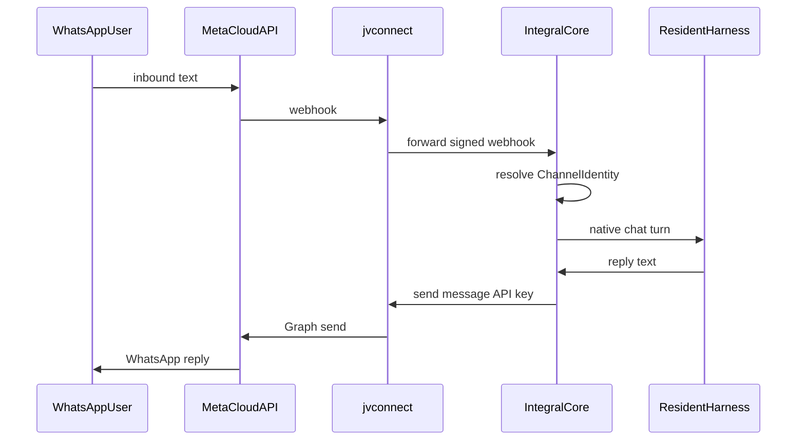

# WhatsApp Personal Channel (via jvconnect)

## Problem Statement

How might we let a personal-workspace user talk to their Integral resident mind over WhatsApp—chat first, then calls—using their own jvconnect phone/API key, without routing Core through jvagent or overloading the data-connector model?

## Recommended Direction

**Personal messaging channel adapter**, not a sync/MCP “connector.”

**Phase 1 — Chat MVP**
- Customer configures their own jvconnect phone-bound API key + webhook registration into Integral.
- Reuse existing `ChannelIdentity` OTP link (phone → user); verified identity required before turns.
- New inbound webhook adapter in Core (signature verify) → resolve principal/personal workspace → drive a **native chat turn** (same harness path as in-app chat), with staging/text-approve reuse where freeform approvals apply.
- Outbound replies via jvconnect Messaging API (`/api/v1/meta/whatsapp/messages`), not long-lived Meta tokens in Core `.env`.
- Settings UX: “WhatsApp channel” (link phone identity + paste jvconnect credentials / register webhook). Product language may say “connector”; implementation stays a **channel adapter**, separate from Gmail/QB/`IS_CONNECTED_TO`.

**Phase 2 — Voice (immediately after chat confirmed)**
- Inbound WhatsApp Cloud Calling via jvvoice; Core owns accept/disconnect + an Integral interact/session bridge (do **not** call jvagent Orchestrator).
- Outbound place-call only if jvvoice gains that capability; until then, receive-first is the honest scope.
- Requires LiveKit Cloud + jvconnect calling credentials; coexistence/WA Web paths are out.

## Why this direction (stress test)

| Criterion | Assessment |
|-----------|------------|
| User value | Painkiller for “talk to my Integral mind from my phone” — matches boss ask + personal-workspace persona |
| Feasibility | Chat reuses ChannelIdentity, native chat, jvconnect’s proven agent contract; voice needs a new jvvoice→Integral bridge |
| Differentiation | Substrate + resident mind on WhatsApp, not a generic WA inbox; customer-owned numbers keep tenancy honest |

**Weaker alternatives rejected for v1:** org business-line routing, unified Slack/Telegram fabric, jvagent-as-middleware, hanging chat on data connectors, voice-first.

## Key Assumptions to Validate

- [ ] Personal user ↔ one jvconnect phone is enough for v1 (no multi-number / org WABA routing yet)
- [ ] One webhook forward per jvconnect phone is acceptable (Integral owns that phone; no shared jvagent forward)
- [ ] Native chat turn path can be invoked from a service/webhook principal without breaking workspace scope, approvals, or receipts
- [ ] Customer can obtain and paste a jvconnect API key; ops docs are enough (no deep jvconnect OAuth into Core for MVP)
- [ ] 24h session window + template rules can be handled with “user messaged first” MVP (templates deferred)
- [ ] jvvoice can be pointed at an Integral interact URL with parity to today’s jvagent callback (Phase 2 spike)

## MVP Scope (Phase 1)

**In**
- Link/verify WhatsApp identity (existing)
- Store customer jvconnect API key + phone binding (workspace/user-scoped secrets)
- Register/receive jvconnect webhook forwards
- Inbound text → resident harness turn → outbound reply via jvconnect
- Basic settings UI + failure visibility (auth, window closed, unverified identity)
- Preserve Core policy: approvals, workspace gate, no Meta tokens in browser

**Out (Not Doing — and why)**
- Org-facing business number / `SERVES_USER` productization — different principal and routing model
- Voice / jvvoice — Phase 2 after chat works
- Slack/Telegram / generic channel fabric — premature abstraction
- Data-connector catalog / `IS_CONNECTED_TO` — wrong lifecycle (sync vs messaging)
- jvagent as transport — retired for Integral harness; duplicates runtime
- Full duplex human+AI inbox (jvconnect Ably UI as Integral product) — blurs boundaries
- Template campaign / marketing send — not personal mind chat
- Migrating notification `whatsapp_service` Graph calls to jvconnect — nice follow-on, not MVP blocker
- Groups, Flows, coexistence Web paths — out of Cloud API personal-chat path

## Open Questions (resolved in Phase 1 spec)

See [SPEC-whatsapp-personal-channel-chat.md](SPEC-whatsapp-personal-channel-chat.md) for decisions on secret storage, chat-thread binding, media scope, and settings naming.

## Related artifacts

- Phase 1 chat spec: [SPEC-whatsapp-personal-channel-chat.md](SPEC-whatsapp-personal-channel-chat.md)
- Phase 2 voice spike: [SPIKE-whatsapp-voice-jvvoice.md](SPIKE-whatsapp-voice-jvvoice.md)

## Status

Idea confirmed 2026-11-18. No implementation until Phase 1 spec is approved.
