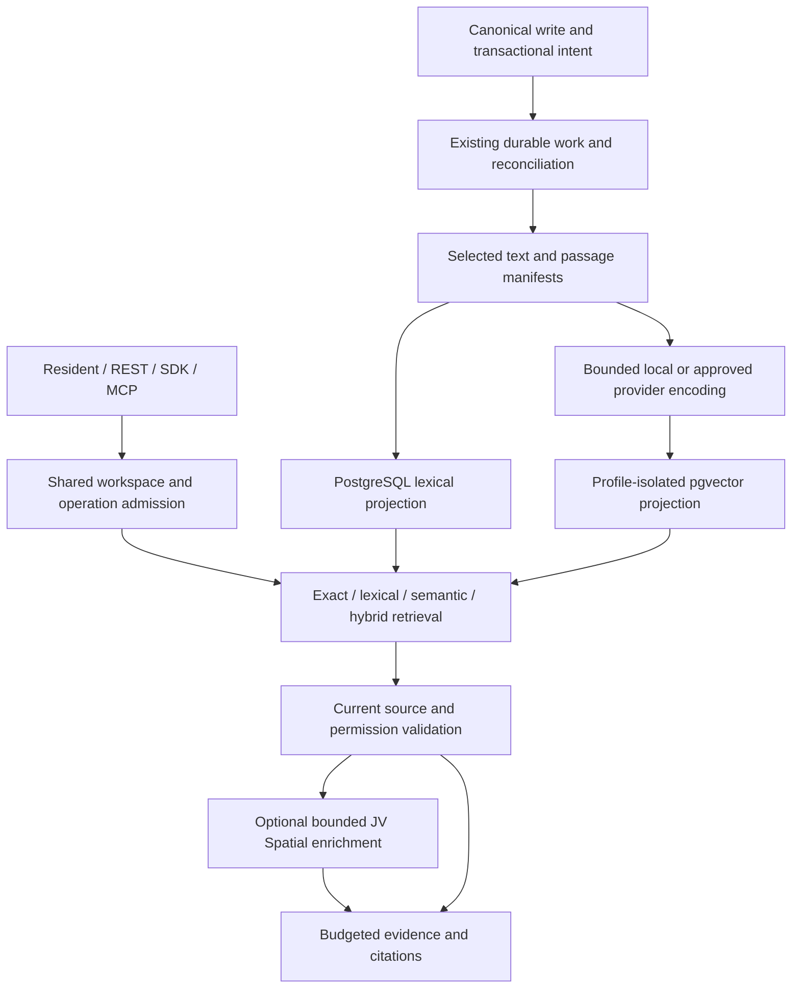

# Integral semantic search improvement plan and contract — proposal v1

**Status:** Approved direction; index hardening, model migration and App discovery implementation in review. The migration, broader integration and production qualification gates below remain open.
**Date:** 24 October 2026. **Draft revision:** 6 — bounded model-routing overhead and turn-owned cloud transport; remaining gates explicit.
**Decision owner:** Integral product architect, with retrieval, runtime, authorization, SDK and frontend engineering review.
**Implementation base:** `main` at `37219ddee21690429455a170393e49dbb7f1eed2`, including merged #171, #172 and #176. PR #173 remains a separate draft on `codex/semantic-search-hardening`; it is not a release or production deployment.
**Decision record:** [ADR-017](../backend/adr/017-graph-guided-knowledge-retrieval.md).

This document records the delivery contract and remaining implementation plan. The [current indexing guide](../backend/semantic-indexing.md) and [voice and embedding guide](../backend/voice-and-embedding-models.md) describe shipped behavior. Requirements below are proposed obligations, not claims that the baseline already meets them. This revision replaces the unimplemented embedding-free proposal.

## Implementation boundary

The initial delivery implements independent pinned tokenization, bounded local inference admission and microbatches, query priority with background slices, shorter cloud-query deadlines, independent indexed lexical publication, per-document integrity manifests and repair, verified unchanged-vector reuse, independent top-k fusion, small-scope exact ranking and capped workspace/profile HNSW maintenance. Status reads perform no inference. Candidate validation overlaps at most four ordinary policy checks and stays serial inside a caller-owned transaction. Feed and Track search hydrate the bounded ranked IDs through their ordinary list admission, without scanning unrelated pages or retrying rate-limit failures through another endpoint. Settings identify server versus device processing.

The follow-on implementation separates configured/building and pinned serving profiles. A rooted, keyset-paged Workspace → Tracks registry → Track → Entry Walker retains a constant-depth frontier. A verification sweep checks actual projection manifests before transactional cutover; source-intent epochs serialize with canonical Entry commands and Track index configuration. A committed-intent journal catches up Entry changes after the full verification sweep. A cutover holds both the epoch and rebuild-request rows, checks owner/revision/profile/lease and actual tail manifests, and rejects outstanding work. Track-wide changes restart verification; ordinary Entry writes do not require a quiet whole-corpus window. Older partial requests restart under the journal protocol. Enumeration alone cannot activate a model. The previous provider is used during a migration only with explicit continuation consent; otherwise its existing authorized projection remains available for keyword retrieval. Cancel is owner/revision-bound, and superseded requests stop being scheduled immediately.

Interactive scope admission now avoids scanning creation-time ownership grants when rooted Track coverage already admits the entire scope. Partial-access discovery removes duplicate grants before canonical admission. Rebuild pages batch fresh containment and schema reads. Retrieval-worker recovery fences on unique lease tokens instead of exact floating-point timestamp equality; graceful shutdown releases its owned rebuild claim. Excluded-content invalidation resolves its canonical workspace rather than relying on an optional Entry cache.

The native resident exposes the existing read-only `integral_query` as a foundational schema, when present in the authorized catalogue. Focused knowledge lookups need no full Insights workflow expansion; current broker, App-operation and per-result policy gates remain unchanged. Other workflows still use progressive discovery/loading. Route resolution coalesces owner reads within one fresh admission check, never across requests. Custom model endpoints reuse guarded connections only within the same physical model and turn; outbound checks and current credential/permission admission remain mandatory. Content-free phase diagnostics distinguish host admission from provider startup. Automatic Light routing has one transport attempt and a bounded total model-pass deadline, including schema retries; known transient timeouts hand off through current Heavy admission. Workers page filtered queue candidates with constant-size rotating cursors instead of hydrating every queued item on each poll. This does not remove the authority-free Light routing pass or establish a cloud latency SLO.

App SDK discovery now resolves governed Track/type selectors before index ranking, instead of materializing the first 500 Entries. Explicit Entry-ID narrowing retains its 500-ID contract. Current canonical containment, type and audience are rechecked after ranking. Type projection adoption keeps existing untyped readers and source hashes compatible and reuses verified vectors; shared type-selector indexes are built concurrently by worker maintenance, never by a search.

Passage ranking now uses bounded candidate overfetch and repeated-title/paragraph
discounts after independent branch fusion. Vector-only title resemblance has
less weight than substantive evidence unless the query identifies the title;
exact names, identifiers and lexical title matches retain their weight. This
reuses current vectors and canonical passage offsets, with no additional
inference or migration. It improves the evidence window rather than promising
that the first result is always correct. See the current indexing guide for
the rank identifier, candidate caps and remaining relevance qualification.
Title-only hits can also include bounded supporting canonical text, explicitly
marked as context rather than a ranked match. The resident must not treat a
record label as answer evidence; insufficient passages require an authorized
source read or an explicit statement that the detail is unavailable.

The attachment follow-on adds canonical file sources to the Entry passage
adapter: allowlisted file properties, native PDF/Office/text extraction, section
locators and source-bound multimodal image descriptions and visible text. It
does not use OCR. File-kind/filename selectors narrow candidates before ranking;
blank queries support bounded file discovery. Search rechecks current parent
edges, access, scan state and file hashes. Model analysis runs as leased,
stateless background work through the existing model admission/accounting plane,
with no tools, chat history or workspace inventory. Unsupported adapters do not
fund these calls. Attachment-free fingerprints remain compatible with existing
indexes. See [attachment contracts](../backend/attachment-agent-contract.md) for
the resource bounds and partial-coverage behavior.

This is not a claim that every exit gate below has passed. The broader schema/restore/lifecycle invalidation audit, resumable passage-level scheduling, full workspace fairness, query-vector caching, pooled provider transports, cleanup/retention, qualified rollback and production quality/resource gates remain open. Existing Track status still uses bounded diagnostics; workspace migration verification is separately paged without a 1,000-source completion shortcut. Local transaction and browser evidence cannot establish a cloud capacity or freshness SLA.

The qualification suite includes real encoder/PostgreSQL tests, a scoped ANN exact oracle, authority regressions and a populated browser preview. Production hardware sizing, a held-out 200-query relevance set, 100-tenant load cells and a two-hour container soak remain release gates. Do not treat this initial PR as approval to promise the SLOs in section 12 or increase production workers.

## 1. Outcome and architectural decision

Integral needs relevant, current, permission-correct semantic search at low latency as workspace content and concurrent tenant activity grow. Retain embeddings for discovery by meaning; combine them with independently indexed lexical retrieval, exact/structured queries and selective JV Spatial graph enrichment. Improve the existing implementation before adding another database or search cluster.

The initial hosted target remains PostgreSQL plus pgvector, JV Spatial's canonical graph, the existing durable-work substrate and one bounded embedding execution facility. The existing pinned CPU ONNX default remains the compatibility starting point. Workspace-owned cloud/provider overrides remain supported. No GPU, separate vector database, Redis, generated knowledge corpus or mandatory language-model reranker is introduced by default.

Embedding models and chat Light/Heavy profiles are independent. Changing a chat model, reasoning effort or routing policy must generate zero search-index rebuilds. Source changes update the affected projections; an embedding encoder/composition change creates an isolated space and a deliberate migration. Search behavior is contractual; a particular model or algorithm can evolve after qualification.

### 1.1 Product requirements

- Find prose despite different wording, without requiring developers to model every concept first.
- Preserve reliable exact names, identifiers, phrases and structured facts alongside semantic matches.
- Make new and edited eligible content searchable automatically; exclude deleted, moved, stale or revoked evidence immediately through canonical validation.
- Provide the same governed evidence to resident chat, REST, App SDK and external MCP consumers.
- Keep server CPU, memory, provider usage, database work and queued work bounded across tenants.
- Expose understandable readiness, rebuild progress and degraded search without asking lay users to operate an index.
- Preserve the local/private default and explicit consent for cloud processing. Do not require a second subscription to use basic search.

### 1.2 Non-goals for this delivery

No universal ontology induction, arbitrary reasoning engine, automatic workspace-wide summaries, cross-workspace federation or separate Markdown authority store. Comments, audio/video content and image-only document pages need additional source adapters and access/provenance qualification; Entry/attachment text coverage must never be advertised as coverage of those sources. Images use configured multimodal models, without OCR. OKF export/import remains optional later interoperability work. Search results cannot establish complete collections or exact totals.

## 2. Verified baseline and critical findings

These describe the historical inspected baseline before this PR, not the current implementation boundary above. They are code observations, not production latency measurements. Preserve the baseline/evaluation split when qualifying improvements.

| Area | Inspected behavior | Improvement and priority |
|---|---|---|
| Local default | Pinned MiniLM L6 v2 ONNX CPU encoder, 384 dimensions, default 160-token passages with 24-token overlap; intra-op threads default 1 and inter-op threads 1. | Preserve initially; qualify resource use and relevance rather than changing models by reputation. P0. |
| Local execution | Process-local singleton; passage queries and indexing serialize encoding through the same `RLock`; legacy encode helpers use the same model through a different call path. | One bounded admission/execution contract, interactive priority, bounded native batches, audit every caller. P0. |
| Hosted warmup | Startup warms the local encoder when semantic storage is selected. Model residency is per process, not per tenant or whole deployment. | Role-aware warmup, explicit capacity and replica accounting, no unnecessary cloud-only weight load. P0. |
| Cloud overrides | Owner-selected OpenAI/OpenRouter/Ollama/custom connections; explicit text egress consent; fresh credential resolution; vector/shape checks; custom endpoint guards. | Preserve these controls; qualify provider capabilities and separate interactive from background deadlines. P0. |
| Local coupling | Provider profiles start from deployment composition settings; `passage_tokenizer()` loads the local inference model even for cloud searches/indexing. | Load the composition tokenizer independently of ONNX weights; preserve identity or migrate explicitly. P0. |
| Query transport | Cloud calls create a client per encoding operation; total limit 40 seconds, connect/read limits, maximum 32 texts and 8 MiB response. | Reuse bounded safe transports where possible; keep fresh credentials and endpoint/DNS protections; short query deadline and isolated backfill retries. P1. |
| Vector ranking | `PassageStore.search` materializes all scope-matching rows and computes exact vector and lexical rankings before final `LIMIT`. HNSW exists but this path deliberately avoids it. | Separate top-k branches, scoped exact search for small selections, qualified ANN for large selections. P0. |
| Lexical ranking | `to_tsvector('simple', content)` is calculated in the query; passage DDL does not define a materialized lexical column/GIN index. | Independent lexical projection and indexed matching, not whole-scope text processing per search. P0. |
| App candidate selection (PR #172 only; not in PR #171) | SDK Walker selects at most 500 matching Entry IDs before passage relevance ranking; explicit ID lists also have a documented 500 cap. | Preserve the explicit-ID contract; replace discovery-time first-500 truncation with authorized scope/type predicates and relevance ranking. P0. |
| Scope admission | Workspace search resolves readable Tracks and direct Entry grants, with potentially repeated canonical/policy reads; a 5,000-resource bound exists. | Measure and batch narrow scope admission; no uncapped per-query enumeration or permissive cache. P1. |
| Index lifecycle | Transactional intents, generations, leases, source checks, guarded publication and retry/reconciliation already exist. | Extend and test these mechanisms; do not replace them with an unrelated queue. P0. |
| Repair | Same source hash can skip enqueueing from an existing receipt; stored passage integrity is not established by that shortcut. | Independent manifests and reconciliation repair missing/corrupt derived state without a user edit. P0. |
| Update efficiency | Delivery encodes all passages of a changed document. Source hash also includes routing/metadata/definition data. | Separate source validity from encoder-input identity; reuse unchanged vectors within the same authorized profile. P1. |
| Rebuilds | Workspace model save immediately selects the new profile; rebuild scan walks global Entry pages, queues workspace work and ends in `queued`. | Distinguish configured, building and serving profiles; workspace-directed enumeration; verified catch-up and activation. P0. |
| Status | Track checks inspect at most 1,000 sources/jobs and distinct stored hashes, not complete passage manifests. Status can call the embedding provider. | Durable generation progress, integrity evidence, bounded read-only status; explicit tests/probes perform inference. P0. |
| Retention | Old spaces remain; store instances and model-specific indexes can accumulate with profile churn. | Bounded caches, bounded pending migrations, managed index/space retention and cleanup. P1. |

Inspected sources: [encoder](../../backend/app/services/retrieval/embedding_model.py), [ONNX runtime](../../backend/app/services/retrieval/onnx_text_encoder.py), [profiles and composition](../../backend/app/services/retrieval/index_definition.py), [configuration](../../backend/app/services/retrieval/embedding_configuration.py), [transport](../../backend/app/services/retrieval/profile_encoder.py), [passage store](../../backend/app/services/retrieval/passage_store.py), [retrieval](../../backend/app/services/retrieval/search_service.py), [App search](../../backend/app/services/retrieval/app_search.py), [worker](../../backend/app/services/retrieval/indexing.py), [rebuild](../../backend/app/services/retrieval/workspace_reindex.py), [status](../../backend/app/services/retrieval/index_management.py), [settings](../../frontend/src/features/settings/sections/EmbeddingConfiguration.tsx) and [boot](../../backend/app/main.py).

## 3. Architecture and ownership



**JV Spatial owns** canonical persistence, graph/Walker/projection execution and generic query primitives. **Integral owns** workspace and App admission, search adapters, selected-text policy, embedding profiles, index lifecycle, ranking and evidence. **The harness owns** query intent and explanation; it receives bounded evidence rather than a copy of the workspace.

Derived lexical/vector tables remain in the existing search adapter boundary. They are not a second canonical graph. Lifecycle records with scalar identity, retries and no graph behavior are Objects; configuration and provenance graph participants remain rooted Nodes. New canonical multi-hop work uses a Walker or JV Spatial projection unless a measured, documented exception is justified. Do not put domain names, App heuristics, direct DB imports or bespoke vector SQL into API routes, bundles or generic graph services.

Use existing components first. A deployment may later move the same local encoding interface into a dedicated CPU process/pool if measurements show that inline isolation is inadequate. That topology is optional and must include its IPC/authentication, queue, cancellation, resource and operational costs. It does not imply adding a new search engine.

## 4. Invariants and authority contract

| Invariant | Preservation obligation |
|---|---|
| I-RET-01/02 | Current canonical scope, App operation admission and per-resource read checks precede release of every title, passage, metadata field and citation. Prefilters and caches do not grant access. |
| I-RET-03 | Canonical deletion/archival excludes evidence immediately; derived cleanup is durable and retryable. |
| I-RET-04 | Workspace/profile and readable Track or independent Entry-grant restrictions apply before bounded candidate release; no global top-k then tenant filtering. |
| I-RET-05 | Tag-only and nonselected changes cause no inference; separate encoder input from validity/routing metadata. |
| I-RET-06 | Transactional intent, isolated vector spaces, fenced work and atomic guarded publication remain mandatory. |
| I-RET-07 | Reviewed revision-bound configuration, truthful coverage and explicit queued/building/ready distinctions. |
| I-CONTEXT-01/02 | Same-workspace evidence and permitted graph paths; bounded packing, expansion and history across repeated runs. |
| I-GRAPH-01/02 | Rooted canonical participants; Object work records and derived indexes never substitute for required edges. |
| I-CRUD-01; I-SUBSTRATE-01/I-EXT-01 | Canonical service-layer mutations, domain-neutral contracts and App access through the facade. |
| I-ACCESS-01; I-APP-DEF-01 | Index selection does not invent field permissions or bypass installed-App read operations. |
| I-APPROVAL-01/04/05; I-RUNTIME-01 | Agent configuration changes retain review; host runtime capability and egress policy constrain execution. |

ANN may use an approximate physical search, but workspace/profile/policy predicates remain part of the admitted candidate query. Internal scan of an approximate index is not a grant or evidence of a readable neighbor. Current canonical checks apply after ranking and immediately before graph expansion/release. Retry/refill after stale or denied candidates is bounded and reports underfill. Do not expose inaccessible IDs, counts, raw scores, diagnostics or provider details through warnings.

A timeout or unavailable authorization service cannot become an empty successful answer. Revocation during query embedding, retrieval, continuation or cached-vector reuse must prevent release. Approximate retrieval and index completeness are distinct: a complete index does not make ranked search exhaustive.

Cross-store source and permission checks are fresh best-effort reads, not an atomic historical snapshot. State the validation boundary and recheck before release/expansion; do not claim that every concurrent transaction is observed instantaneously. Test specifically orchestrated revocations and edits at those boundaries.

## 5. Hosted local inference: resources, contention and fairness

### 5.1 Default policy

Retain the pinned CPU model as the baseline, subject to qualification. One loaded artifact is shared by tenants within its encoder process; never load a separate ONNX session per workspace. Model loading must be demand/role aware. Replicas or extra encoder processes can still duplicate memory; a disk cache shares artifacts, not ONNX heap/session memory. Avoid claims based only on model weight-file size.

The inspected production Compose sets `WEB_CONCURRENCY=1`; the runtime also has transport and chat-state constraints. This plan does not authorize raising worker/replica counts to gain embedding throughput. Any topology change must independently qualify resident turn ownership, websocket delivery and the transport contract. Resource accounting must nevertheless test future process/replica duplication explicitly.

### 5.2 One execution/admission boundary

- Inventory passage encoding, legacy query/Entry encoding, capability/package search and readiness probes. Every local caller must use a compatible bounded execution path; preserve separate profiles where semantics differ.
- Replace implicit lock contention with bounded query/background queues and explicit admission before submitting native work. An asyncio timeout around unlimited `to_thread` work is not a CPU limit.
- Give interactive queries priority between small native batches; reserve a fair share for indexing so sustained queries cannot starve freshness. Native inference already running is not preempted by task cancellation.
- Bound active inference, queue length, input tokens, batch bytes and wait time. Drop expired/cancelled work before execution; stop subsequent batches. If hard native cancellation is required, qualify an isolated worker process and its recovery rather than claiming a thread can be killed safely.
- Schedule background work fairly across workspaces and provider profiles; a large import or repeatedly failing model cannot occupy the entire worker cycle. Bound work per scheduling slice, not only total documents.
- Use provider/workspace concurrency and token budgets. Deployment-wide budgets coordinate through existing durable leases/admission when more than one process is allowed; a per-process semaphore is not a fleet quota.
- Core owns generic limits, usage and host hooks. Business billing, plans and commercial quotas stay outside Core.

### 5.3 CPU, memory and startup controls

Start with one local inference slot and the existing one-thread ONNX setting, then tune from measurements. Account for API, tokenizer, ONNX allocations, input/output arrays, thread stacks and database resources. Provider-backed workspaces should not load ONNX weights merely to count or compose text; split tokenizer loading without silently changing its fingerprint or offsets. Other local search consumers may still need the model and must be included in residency decisions.

Keep immutable artifacts prefetched in the image/cache; test startup with network unavailable. Expose a search warmup state separately from application liveness. A failing or cold model must not create restart storms or make login/ordinary CRUD unavailable. Prevent repeated concurrent load attempts after failures. Audit the full image's worker-count and readiness behavior rather than inferring it from one function.

Quantization or another local encoder is an experiment after the baseline. It needs artifact, pooling, tokenizer, numerical, relevance and platform qualification; a changed encoder requires a distinct profile. No silent new weights under an old identity.

### 5.4 Capacity qualification and sizing output

Measure Linux amd64 and arm64 with actual container CPU/memory limits. Initial experiment sizes are 1 vCPU/2 GiB, 2 vCPU/4 GiB and 4 vCPU/8 GiB for the API/encoder tier; these are test cells, not promised minimum requirements. Measure the database separately and repeat one co-located small-host cell so competition is visible. Use the actual production image and disclose process count, architecture and cold/warm conditions.

Record idle/warm/peak RSS and PSS where available, incremental encoder memory, CPU-seconds per 1,000 query/passage tokens, sustainable query rate, queue wait, cold load time, bytes allocated, throttling, event-loop delay and CRUD/chat latency. Compare query-only, backfill-only and mixed workloads across 1/10/50 active search clients and at least 100 unevenly active workspaces. One noisy tenant must not consume all admitted capacity. Cold-provider calls, imports and migrations must be part of the test.

Publish an operating envelope: maximum admitted searches, background rate, observed headroom, model residency count and backlog recovery time per qualified size. Aim for at least 25% memory headroom at qualified peak and no OOM/restart in a two-hour mixed soak. Under overload, reject/degrade within bounded time; do not expand queues or promise unchanged latency above supported capacity.

## 6. Provider and model-profile contract

### 6.1 Defaults and simple setup

Keep the current local MiniLM 384-dimensional profile initially. Preserve existing IDs and vectors unless their actual representation changes. For an owned OpenAI connection, retain the existing `text-embedding-3-small`/1,536-dimensional preset; OpenRouter may expose that model only where available. Ollama/custom choices remain capability-tested, not advertised as universally hosted or available. Anthropic is not offered as a native embedding provider without a supported adapter.

Use one serving embedding profile per workspace and at most one pending migration initially. Avoid creating a distinct ONNX model per tenant. Existing cloud spaces are workspace/owner/connection-bound; do not merge them across tenants merely because model names match. Query and document embeddings always use compatible profiles.

### 6.2 Capability and identity

Represent provider protocol, model, supported dimensions, maximum input, batch constraints, query/document task or prefix requirements, normalization/distance and tokenizer/composition identity explicitly. A synthetic test verifies shape and connectivity, not semantic quality or a provider's immutable revision. A provider alias may change upstream without notice; record a revision/digest when available, warn on detectable changes, and avoid claiming immutable cloud weights when unavailable.

Current configuration permits 16–2,000 dimensions. Preserve that qualified storage envelope initially. A model with a larger default needs a provider-supported lower-dimensional output or an explicitly qualified storage/index change. Never truncate/pad vectors locally or assume equal dimensionality makes models compatible. Treat provider parameters, endpoint authority and query/document prefixes as representation-affecting where appropriate.

Separate encoder identity, composition identity, serving generation and credential reference. Key rotation at the same endpoint/model need not re-encode content, but must revalidate availability. Owner/connection/endpoint changes remain authority-sensitive and may require a migration; no automatic transfer of private funding. Preserve old identities during adoption with an explicit compatibility mapping, not an in-place reinterpretation.

A cloud profile must not change merely because unrelated local ONNX weights change while its composition remains identical. Today the provider profile starts from the deployment profile; correcting that coupling requires explicit old-to-new identity handling so it does not accidentally invalidate every cloud workspace.

### 6.3 Safe and efficient transport

Preserve fresh owner/credential/consent resolution, validated custom hosts, DNS pinning, no proxy-env routing or redirects, bounded response bytes and strict vector validation. Add zero-norm rejection where cosine semantics require it, response-index and cardinality checks, and typed sanitized outcomes for authentication, dimension/input errors, overload and timeouts.

Separate interactive deadlines from background retries. Initial query-encoding sub-budget: 500 ms local warm and 1,000 ms for a qualified nearby cloud provider, within the total search deadline. Those are proposed budgets, not provider SLAs. Batch encoding may retain longer bounded timeouts. Respect Retry-After and apply jittered background retry; do not perform a long retry chain during an interactive request.

Reuse connection pools where supported, but construct fresh authorization per request. Pooling must not freeze revoked keys, a prior owner's authority or custom DNS validation. Isolate circuit state by provider/connection/profile or failing shared dependency as appropriate. One workspace's bad key must not disable every tenant's semantic search.

Record request counts, observed tokens when supplied, latency and bytes by approved internal identifiers. Do not log indexed text, queries, keys, provider bodies or secret-bearing URLs. Estimate versus provider-reported usage must be distinguishable. External text egress is explicit for both document indexing and queries; retries cannot reactivate revoked consent.

## 7. Passage composition and incremental indexing

### 7.1 Independent identities

Separate:

| Identity | What changes it | Consequence |
|---|---|---|
| Canonical source validity | Selected content, effective declaration and canonical location/state | Current evidence validation and projection update |
| Passage representation | Exact encoder input, field identity and composition version | Determine whether a vector can be reused |
| Embedding profile | Encoder/task/prefix/dimensions/distance and immutable identity where available | Separate vector space |
| Lexical representation | Selected text and analyzer/version | Lexical update, independent of encoder availability |
| Serving generation | Backfill/catch-up/activation lifecycle | Pin a query and fence publication |

Routing metadata or a nontext metadata change must not trigger inference if the exact encoder input is unchanged. A tag-only edit causes zero inference. A moved record refreshes containment and validity immediately; reuse a vector only within the same permitted representation/profile, never across an unauthorized workspace/provider boundary.

Use deterministic per-field segmentation with canonical offsets, full tail coverage and explicit oversize failures. Benchmark sentence/paragraph boundaries and small title/field context against the current tokenizer windows before adopting a new composition version. Do not prepend large schemas or the whole App to every passage. Query/document task prefixes are explicit and profile-qualified. Evaluate field-level deduplication so identical field text retains correct provenance and expected evidence coverage.

### 7.2 Vector reuse and publication

Within an authorized workspace/profile, reuse only vectors whose exact encoder-input hash and representation identity match. A changed ordinal is not enough to force inference; an unchanged ordinal is not proof of unchanged content. Scope content hashes/caches so they do not disclose cross-tenant duplication or cause unapproved provider reuse. Bound in-memory caches by entries/bytes/TTL.

Publish a new per-document manifest containing field/offset identity, expected passage count, content/vector checksums, source/profile/generation and publication revision. Verify all batches before atomic replacement; never expose half a document's new vectors. Large documents need bounded buffering or staged derived rows with an atomic manifest switch. Protect in-flight search generations and rollback readers before collecting old rows.

Retain transactional canonical intents, retries, leases and guarded publication. A source edit, profile supersession, grant/consent change or lost lease makes stale work nonpublishable. Audit every canonical lifecycle: create/update/import/seed/connector/SDK, type/declaration changes, moves, archive/delete/restore, App install/uninstall and workspace restore/delete. Normal text writes commit without embedding/network work.

Before each physical remote batch, revalidate current egress authority and effective source selection, not only publication eligibility. Stop later batches when consent or selection is withdrawn. Publication rejection alone cannot undo text already sent to a provider; already dispatched requests remain bounded and their actual outcome is recorded without logging the text.

### 7.3 Repair and rebuild completion

A delivery receipt is not evidence that all passages remain present. Independently compare manifest count and digests with stored rows and canonical selected-text identity. Reconciliation repairs missing receipts, missing/extra/corrupt passages, stale metadata and orphaned derived state, even when the source hash has not changed. Avoid loading the encoder merely to inspect integrity.

Replace workspace-by-global-Entry scans with paged, canonically verified workspace discovery. A scalar location cache is an optimization, never sufficient proof; fallback/reconciliation must find stale-cache cases. Use bounded keysets and scheduling slices, not full graph hydration.

A rebuild moves through queued → enumerating → encoding/catching-up → verifying → ready, with paused/blocked/failed/superseded/cancelled states as needed. Enumeration completion is not delivery completion. Completion needs a defined committed change boundary plus verification of all included manifests/intents. Maximum timestamp, maximum allocated sequence or an empty queue alone is unsafe under concurrent/out-of-order commits. Phase 0 must select and prove the boundary protocol against the actual JV Spatial transaction backend before implementing it.

Persist resumable generation/cursor progress and track pending work through that boundary. Newer writes remain visible as ongoing freshness lag. Whole-generation verification can be expensive: perform it asynchronously, incrementally and with declared semantics. Readiness is point-in-time, not a promise that every future write is already indexed.

### 7.4 Logical storage changes

Implementation should extend existing stores before introducing more registries. The following are logical responsibilities, not a requirement for one new table per row:

| Responsibility | Proposed minimum persisted data | Lifecycle/authority |
|---|---|---|
| Workspace search selection | Serving/pending profile references, configuration revision, generation and consent binding | Extend the rooted workspace configuration; owner-controlled and revision-bound. |
| Lexical projection | Source/field/offset identity, selected text, analyzer version, indexed terms and canonical scope keys | Derived adapter rows, maintained independently of vector readiness. |
| Passage vectors | Representation hash, profile, vector and canonical source/field provenance | Derived rows; no cross-profile comparison or permission authority. |
| Document manifest | Expected passage identities/count/digests, source validity, generation and publication marker | Atomic document visibility and integrity verification. |
| Delivery/rebuild work | Source/profile identities, cursor/boundary, lease/generation, attempt and safe error state | Existing Object work mechanism; no private provider keys or copied source text. |
| Index inventory/retention | Physical index identity, compatible profile layout, build/validation state and reader-safe retention state | Operator-owned derived maintenance; bounded and resumable. |

Define unique keys, scan indexes, lease compare-and-set predicates and crash recovery with the schema review. Lexical text may be shared between compatible profile generations only if its source selection, access binding and retention are identical; avoid copying every text row for every model unnecessarily. No deduplication shortcut may make one tenant depend on another tenant's private data or credentials.

## 8. Fast retrieval and scale-aware query execution

### 8.1 Independent candidate branches

Materialize selected lexical text with a versioned analyzer and appropriate GIN indexes. Support weighted titles/field labels, exact identifiers/phrases and an explicitly qualified language strategy. PostgreSQL built-in lexical rank is not BM25; do not describe it as such. Optional trigram lookup belongs on short labels/names where useful, not indiscriminate whole-body fuzzy scans.

Execute lexical and vector top-k branches independently within the admitted scope, with bounded branch budgets, then fuse rankings using the existing RRF approach. Deduplicate passages and records, favor exact requested identifiers and diversify repeated overlapping chunks. Measure branch recall and fusion quality. Include repeated operational boilerplate that can dilute a short relevant paragraph; test paragraph-aware composition behind a new composition/profile identity rather than silently rewriting existing vector inputs. Do not compute full-scope window rankings or retain every passage merely to fuse a small final list. A rank score is not calibrated confidence.

Lexical search must work without a usable embedding model, key or local ONNX weights. Preserve the current `graph` keyword-mode meaning for compatibility; a new explicit lexical capability must not relabel JV Spatial ontology traversal as keyword search. Additive version/capability negotiation should clarify these modes before deprecation.

### 8.2 Exact versus approximate vector plans

Retain exact vector ranking for demonstrably small/selective scopes and explicit ID lists. Introduce HNSW nearest-neighbor plans for larger scopes only after matching the indexed expression/operator/profile predicate and proving behavior with `EXPLAIN (ANALYZE, BUFFERS)`. Measure the crossover by actual rows, dimensions, selectivity, hardware and load; no universal hard-coded threshold is justified yet.

Filtered ANN must preserve tenant and small-scope recall. Qualify iterative scans where the deployed pgvector extension supports them; verify the extension version rather than inferring it from a Python package. Evaluate partial indexes, shared-profile partitions and selected large-tenant partitions against index-count, build-time and write-amplification costs. A global index over many tenants can still suffer cross-tenant candidate competition even when final rows are filtered.

Do not create one physical HNSW index per workspace by default. Current per-profile index creation combined with workspace-specific cloud profiles can grow without bound. Phase 4 must choose a measured physical layout and management policy: small/rare profiles may use bounded exact search; larger profiles receive managed ANN indexes under explicit limits. Share compatible physical infrastructure only while preserving existing logical vector-space and tenant predicates. Include migration/retention overhead in the decision.

Separate OR-shaped direct Entry grants from broad readable-Track branches if that improves query plans, then merge/deduplicate under the same ranking contract. Preserve independently granted Entries without granting their parent Track. Stale or denied candidates may require bounded refill; reaching the refill/scan/time limit returns an honest partial result, not a broader unauthorized search.

### 8.3 Admission without full-corpus enumeration

Resolve App/Track/type identity through canonical rooted metadata and stable manifest keys. Push validated scope/type predicates into indexed ranking. Replace the App discovery path that picks the first 500 Entries before ranking. An explicit `eligible_entry_ids` list remains an intentional narrowing with documented bounds and `[]` semantics; an omitted list searches the admitted scope.

Avoid loading all readable Entry IDs or the whole workspace ontology on each request. Batch canonical location/policy reads, reuse only request-local admission safely, and measure Track/direct-grant discovery cost. Any durable access projection needs revision/invalidation correctness and fresh release checks; it is a candidate accelerator, never an authority store. No backend-specific canonical SQL is added outside JV Spatial.

### 8.4 Query embedding cache and execution budgets

Cache query vectors only, keyed by workspace, authorized provider/profile/task identity and exact normalized query; normalization must preserve meaning. Use bounded TTL/bytes, single-flight for identical authorized requests and no raw-query logging. Credential/owner/consent checks still apply before use or provider dispatch. Do not cache final evidence or permission decisions across requests. Sharing cached vectors across principals within a workspace requires an explicit confidentiality policy; begin principal-scoped.

Initial default budgets remain small: up to 150 branch candidates, 20 returned Entries and the existing 1,200-token passage budget, within documented request caps. The branch scan work and postauthorization refill need separate hard limits; limiting output is not limiting database work. Apply a total proposed search deadline of 3 seconds, component timeouts, bounded queue admission, statement timeout and downstream cancellation. Native compute and database cancellation must be verified, not assumed from cancelling an awaiting coroutine.

For graph enrichment, use only selected permitted roots and declared relevant relations, normally depth 1–2 and a separate small byte/node budget within the caller's overall evidence allowance. Revalidate paths and do not infer undeclared causation. No automatic enrichment when the passages already answer the question. Exact collections and aggregates use structured contracts, not search top-k.

## 9. Model migration, failure and retention

### 9.1 Configured versus serving profiles

Introduce explicit `serving_profile`, optional `pending_profile`, configuration revision and generation state. Saving a new choice validates ownership, capabilities and egress consent, then durably schedules the pending build. Searches continue using a compatible permitted serving profile until the new generation passes coverage/quality checks. Every query pins one serving profile/generation; it never compares a query vector from one model with another model's rows.

Continuing the former serving profile is allowed only while its credentials, owner authority, consent and host policy remain valid. If the user revokes a provider or explicitly requests immediate cessation, stop its new calls immediately. Offer lexical degradation or an explicitly authorized switch; do not silently keep funding the old provider for availability. Requests already sent cannot be recalled; document and bound them.

After backfill and boundary verification, atomically activate the pending generation under a revision check. Edits during migration must update the required serving/pending projections without losing newer changes. Dual-writing is temporary and observable; failure to maintain an old space must be visible. Limit to one pending migration per workspace. A newer change supersedes work rather than building unlimited profiles.

Provide explicit Cancel pending change and Roll back actions while the old profile remains qualified and authorized. Rollback must verify catch-up to current sources; an old snapshot cannot revive deleted or edited passages. If older compatible vectors are unavailable, rebuild rather than pretending rollback is instantaneous.

### 9.2 Degradation and cleanup

On an embedding outage, return indexed lexical results with `requested_mode`, `effective_mode`, `degraded`, reason and evidence limits. Where only canonical bounded keyword fallback exists, label that separately. Do not imply semantic-quality equivalence or complete coverage. A timed-out search is not proof that nothing exists. Recover automatically after a bounded isolated cooldown.

Bound active/pending/retained spaces, in-memory stores, connection pools, query caches and database indexes. Define an operator-configurable retention window and byte budget; publish their defaults only after sizing. Cleanup removes derived rows/indexes only after no active query, migration, rollback reader or recovery lease needs them. Respect current workspace deletion and tenant-retention rules. Do not delete shared provider credentials or canonical content. Use concurrent index maintenance where supported and avoid DDL on the latency-sensitive first query.

## 10. Shared search and evidence contract

Preserve current endpoints/facade imports initially. Add response fields compatibly or negotiate a contract version. REST `/api/retrieve`, resident `integral_query`, App `ToolContext.search_entries`/SDK and MCP share scope admission, ranking, profile resolution, degradation, budgets and current-source checks. App records remain available through declared operations; a generic search mode never bypasses that boundary.

Illustrative additive response metadata, not an implemented wire schema:

```json
{
  "contract_version": 1,
  "requested_mode": "hybrid",
  "effective_mode": "hybrid",
  "degraded": false,
  "serving_generation": "generation-reference",
  "coverage": {
    "state": "verified_at_boundary",
    "observed_at": "2026-10-24T12:00:00Z",
    "current_write_lag": "unknown"
  },
  "limits": {
    "candidate_limit_reached": false,
    "output_truncated": true,
    "execution_complete": true,
    "exhaustive": false
  }
}
```

Each hit retains current source ID/title/revision, canonical field/offset evidence and `action_url`, with compatible profile/generation provenance. Serving coverage, ANN approximation, execution completion and output truncation are separate facts. Do not reveal private connection IDs, rebuild counts or owner credentials to ordinary readers. Management diagnostics require current configuration authority; ordinary search gets only safe scope-level quality signals.

The resident should retrieve small relevant evidence once, broaden/refine only when needed, and use returned citations. It must not interpret zero hits as absence or reread entire records automatically. Preserve context budgets across tools, Light/Heavy handoffs, compaction and restored chats. Test a growing workspace and repeated runs so better search does not recreate prompt bloat.

## 11. Settings UX and operations

Keep AI Models → Models → Embeddings as the single configuration location. Providers remains the private connection catalog. Label the default **On this server** in hosted mode, with concise text that processing uses the deployment's compute. Local installations may use **On this device** only when that statement is accurate. Do not imply the hosted model runs in the browser or has zero operating cost.

The simple view shows current serving choice, readiness/freshness summary and Change model. Provider choice presents qualified presets and explicit cloud-text consent. Advanced controls contain model ID, supported dimensions, capability details and migration diagnostics. Present model count and accordion behavior consistently with the rest of AI Models.

A change preview states what will be rebuilt, whether current search remains available and which provider will receive text. Distinguish Saving, Building, Verifying, Ready and Needs attention. Test model uses synthetic text, shows a toast and never activates a choice. Save/test/cancel/repair results use toasts; durable readiness/progress belongs in a concise persistent status panel, not transient success text among controls. Preserve failed drafts and workspace/principal isolation in query keys.

Status reads must not issue fresh paid inference on every polling interval. Use last verified health with a timestamp and bounded background probes; explicit Test is a deliberate call. Detect capability/configuration failures without marking the entire application unhealthy. Advanced retry/rebuild/configuration operations retain current authority and agent approval.

Operator controls cover CPU/queue/provider budgets, query deadlines, batch slices, generation retention and index management. Reuse existing settings where their semantics fit; introduce the minimum new controls with validated ranges and documented scope. This proposal does not add ENV keys to the runtime. Phase-specific implementation must document exact new keys and precedence before exposing them. Existing `EMBEDDING_MODEL_THREADS`, eager-load/cache/artifact settings, chunk/overlap settings, worker interval/batch size and retrieval limits remain compatibility inputs.

## 12. Observability and acceptance targets

### 12.1 Measurements

Use correlated spans for admission, scope resolution, queue wait, tokenization, query embedding/cache, lexical/vector branches, fusion, canonical authorization/source validation, graph enrichment and response packing. Separate retrieval time from LLM generation and time to first answer token. Record requested/effective strategy and degradation reason.

Monitor query p50/p95/p99, timeout/underfill rates, ANN recall probes, stale-candidate drops, token/byte counts, per-stage database work, CPU throttling, memory, queue age/depth, indexing throughput, retries, repair lag, profile/index count, migration age and provider use. Avoid unbounded metric labels: no arbitrary query, Entry or workspace IDs as global time-series labels. Use access-controlled sampled traces/aggregates for tenant diagnostics.

### 12.2 Proposed qualification gates

All numbers below are targets to validate, not measured promises. Publish results with hardware, admitted load, database size, provider/region, cache state and background activity.

| Measure | Initial target |
|---|---|
| Core retrieval after query vector is available, including admission and current-source checks | p95 ≤500 ms, p99 ≤1,000 ms on each published supported load cell |
| End-to-end warm local hybrid search, excluding answer generation | p95 ≤1,000 ms, p99 ≤2,000 ms |
| End-to-end warm cloud hybrid search | p95 ≤1,500 ms on a qualified provider/region; publish measured provider contribution and disclose failures to meet this target |
| Interactive deadline | 3 seconds total including queue wait; bounded degradation/error rather than long retries |
| Normal change-to-search freshness below admitted indexing capacity | p95 ≤10 seconds, p99 ≤60 seconds; imports/migrations get separate backlog estimates |
| Relevance | Evidence Recall@20 ≥0.90 and nDCG@10 ≥0.80 on a held-out set of at least 200 labelled queries; report each query category and no material regression from the current baseline |
| ANN approximation | Recall@k ≥0.95 versus exact vector ranking at the same admitted scope across tested selectivity/tenant distributions; do not confuse this with end-user evidence recall |
| Restricted scopes/direct grants | Same authorization behavior and explicit underfill; no silent recall collapse behind aggregate metrics |
| Noisy tenant under globally admitted capacity | Other tenants' p95 increase ≤20% versus the corresponding mixed-load baseline; test sustained query load and large imports |
| Resource stability | Two-hour mixed soak, no OOM/restart, bounded queues/caches and at least 25% memory headroom at qualified peak |
| Primary-write isolation | No synchronous embedding/provider calls; compare write/chat latency under active backfill and document any regression |
| Chat-model independence | Light/Heavy/model/reasoning changes cause exactly zero search rebuilds |

Cold starts and uncached queries must be reported separately and included in user-facing capacity decisions; do not conceal them by showing warm medians only. The same relevance gate applies to each qualified model/profile. If a default misses it for a supported language/domain, narrow the published support or qualify an alternative; do not tune on the held-out test set.

### 12.3 Scale matrix and storage economics

Test 10,000, 100,000 and 1,000,000 passages, with a record-to-passage distribution including long records, duplicate text, rare fields and long-content tails. Add 1/10/100+ tenants, skewed tenant sizes and at least one large tenant; 1/10/50 concurrent readers; 1%, 10% and broad scope selectivity; direct grants, exclusions, metadata/type filters and cold-cache cases. Vary graph degree and Track counts independently from passage count.

Calculate capacity from measured passages, not only record count. Raw float32 vector payload is `passages × dimensions × 4` bytes: one million 384-dimensional vectors is about 1.536 GB decimal; 1,536 dimensions is about 6.144 GB. These figures exclude text, metadata, row overhead, HNSW, replicas, WAL, dead tuples and backups. Pending/retained generations add further storage and CPU. Publish actual total disk/working-set/index-build headroom and retention cost before promoting a higher-dimensional hosted default.

Use exact-oracle comparisons offline, actual query plans and a two-hour mixed workload. Estimate time to initial index and backlog recovery from measured throughput and arrival rate. If indexing arrival rate exceeds sustained capacity, advertise backlog/limits and apply admission; no finite queue or worker count fixes an indefinitely overloaded deployment.

## 13. Implementation sequence and review gates

The steps below are ordered work packages, not a commitment to a number of PRs. Keep each change reviewable, preserve the primary checkout and obtain permission before creating another worktree. Planning does not authorize a release, deployment or merge.

### Phase 0 — Baseline, contracts and reproducible qualification

**Work:** inventory all search/encoder callers and source lifecycles; reproduce the findings in §2 with focused tests; capture real local/default and a consented cloud path. Build labelled queries, held-out splits and synthetic scale generators outside maintained docs. Record extension/runtime versions, full request timing, resource use and current exact/lexical/hybrid quality. Select the committed-boundary protocol and define capability/response/state schemas before changing execution.

**Areas:** `services/retrieval/*`, `api/retrieve.py`, `schemas/retrieve.py`, App facade and Walker tests, `tests/test_embedding_configuration.py`, semantic/pgvector tests and `docs/ops/QUALIFICATION.md`.

**Exit:** baseline report with plans, resource envelope gaps, current quality, frozen evaluation criteria, supported backend matrix and approved authority/state transitions. No claim of scale from a small smoke.

### Phase 1 — Correctness, integrity and truthful lifecycle

**Work:** implement manifests and independent repair; complete durable intent coverage; fair resumable workspace-directed rebuilds; generation boundary verification; read-only status and robust paused/failed states. Retain guarded publication and test rollback across graph/derived storage failure boundaries. Introduce configured/pending/serving state additively before changing activation behavior.

**Areas:** `indexing.py`, `index_management.py`, `workspace_reindex.py`, `embedding_configuration.py`, `workspace_model_configuration.py`, schemas and `tests/contract/test_semantic_index_transactions_postgres.py`.

**Exit:** loss/corruption repairs without edits, >1,000-source rebuild and concurrent commits complete correctly, queued never means ready, stale jobs/approvals/owners cannot publish, current revocation/deletion behavior retained.

### Phase 2 — Hosted inference control and provider resilience

**Work:** independent tokenizer loader; bounded execution/admission and fair scheduling; safe pooled provider transport; query/background deadlines and scoped failure handling; warmup/health separation; bounded query-vector cache and usage accounting. Inventory legacy helper concurrency and remove unbounded thread submissions. Evaluate optional isolated encoder process only if necessary to meet measured resource/latency gates.

**Areas:** `embedding_model.py`, `onnx_text_encoder.py`, `profile_encoder.py`, profile capabilities, retrieval entry points, `app/main.py`, deployment docs/image and provider tests.

**Exit:** cloud-only retrieval does not load ONNX weights solely for tokenization, long indexing does not monopolize interactive capacity, native cancellation limits are truthful, bad tenant provider leaves others available, Linux container resource tests pass. No automatic API replica increase.

### Phase 3 — Independent lexical retrieval and efficient indexing

**Work:** additive lexical projection/GIN indexes, independent readiness/fallback, field weighting and exact-term handling; split source/representation hashes; same-profile passage-vector reuse and bounded staged publication. Qualify any composition changes separately and preserve existing profile compatibility.

**Areas:** `index_definition.py`, `passage_store.py` or focused adapter modules, `indexing.py`, `search_service.py`, `rank_fusion.py` and PG integration tests.

**Exit:** lexical search survives provider/model outage, query no longer builds full-corpus text representations, one local text edit reuses unchanged vectors, metadata/tag changes have the specified zero-inference behavior, no partial document publication.

### Phase 4 — Scoped ANN, admission and scale

**Work:** separate top-k branches and indexed fusion; exact/ANN planner; small-tenant/direct-grant filter qualification; bounded refill; physical index/partition lifecycle; batch scope/policy work. Replace App discovery first-500 behavior with governed scope/type ranking. Prove current policy and explicit-ID semantics across adapters.

**Areas:** `passage_store.py`, `search_service.py`; retain the merged PR #172 App search/Walker authority contract; canonical query improvements in JV Spatial where needed, database/load tests.

**Exit:** physical plans use the intended indexes, relevant records after old caps are found, exact-oracle ANN recall and latency targets pass at scale, no global candidate starvation, no unbounded per-profile index creation. Retain a safe exact/lexical fallback and rollback toggle.

### Phase 5 — Profile migration and user controls

**Work:** pending build and serving-profile readback, atomic activation/catch-up, cancel/supersede/authorized rollback, retention/cleanup; simple Embeddings UI, server/device wording, qualified presets and explicit consent. Preserve provider/private ownership rules and toast behavior.

**Areas:** `embedding_configuration.py`, `workspace_reindex.py`, configuration/status schemas, `api/aiConfiguration.ts`, `EmbeddingConfiguration.tsx`, model-category tests, provider-delete/ownership flows and ops docs.

**Exit:** usable search during an authorized migration, zero cross-profile mixing, revocation stops egress, complete progress for large workspaces, safe cleanup and real browser smoke with two principals/workspaces.

### Phase 6 — Native, SDK and MCP integration

**Work:** common evidence/capability metadata, additive wire compatibility, bounded graph enrichment, updated Insights/indexing guidance and recovery hints. Ensure installed Apps use declared operations and external MCP callers receive the same authorized quality and limits. Reconcile search-mode settings with the actual configured serving capability.

**Areas:** `schemas/retrieve.py`, retrieval routes/adapters, ToolContext/SDK contracts, `agent/skills/integral-insights`, indexing skill, tool manifest/capability map only if the surface changes, graph-context and frontend result tests.

**Exit:** transport parity, stable citations, correct degraded/partial results, no permission bypass, repeated-turn/context restoration tests and real agent task readback pass.

### Phase 7 — Qualification, rollout and operating guidance

**Work:** full correctness/resource/relevance/load suite; clean wheel and production-image smoke; staged shadow comparison, limited activation, rollback drills, cleanup and concise operating runbooks. Select the final default CPU limits, deadlines, index planner thresholds and retention values from evidence. Publish resource/cost envelopes for local and cloud profiles.

**Exit:** qualification record tied to exact source/artifact/configuration, all required checks green, achieved versus missed targets explicit, restore/rollback verified and no unresolved P0 authority, freshness or reliability defect. Production promotion requires its own authorization.

## 14. Migration and backend compatibility

Use expand → backfill → verify → shadow-compare → activate → retain → clean up. Preserve canonical content, existing local profile IDs and provider selections. New columns/tables/manifests/state are additive initially; old readers remain supported for a defined window. Do not relabel legacy single-vector data as passage coverage.

The inspected PostgreSQL passage path is the first fully qualified target. Atlas retains its adapter behavior; null/graph-only installations retain explicit degraded capability. Do not advertise provider overrides, ANN behavior, transactions or recovery on an adapter that has not passed them. A local JSON installation may use its configured Postgres side index only if supported and clearly documented; this plan does not silently add one.

Search migrations must not block all API processes on heavyweight index DDL. Use existing migration mechanisms, cross-process coordination and bounded concurrent index build/validation where supported. Plan for interrupted builds and disk exhaustion. Rollback toggles switch algorithms/readers only to compatible, fresh and authorized projections. Permission, source and provider policy are never rolled back with an index.

Backups distinguish canonical data, durable intents and reconstructible derived state. Restore tests reconcile manifests and serving generations before asserting readiness. Retention cleanup cannot delete active readers' data; workspace deletion invalidates evidence and egress immediately while derived cleanup retries. Multi-process/cloud rollout remains subject to current runtime transport/turn-state gates.

## 15. Acceptance scenarios and test strategy

| ID | Required proof |
|---|---|
| S-01 | Default local write → intent → passages → semantic/hybrid search → cited canonical readback, including a long-content tail. |
| S-02 | OpenAI, OpenRouter, hosted/local Ollama and custom adapters pass protocol/shape/timeout tests; each real model is qualified separately, with unsupported choices refused. |
| S-03 | Chat Light/Heavy, reasoning and voice changes create no embedding rebuild; key rotation preserves representation where appropriate. |
| S-04 | Cloud selection has explicit text/query egress consent; owner transfer/key deletion/consent revocation prevent subsequent calls and stale publication. |
| S-05 | Mismatched dimensions/model/task/tokenizer/profile never mix; zero/NaN/Inf/wrong-cardinality vectors and silent truncation are refused. |
| S-06 | Edit one passage; unchanged encoder inputs are reused. Tag-only/nonselected/routing-only changes follow documented inference and freshness rules. |
| S-07 | Delete stored passages/receipt, corrupt a count/hash/vector or add an extra row; reconciliation detects and repairs without a source edit. |
| S-08 | Crash before/after effects, lose a lease, supersede generation or roll back canonical transaction; only valid work publishes and replay is idempotent. |
| S-09 | Rebuild >1,000 records with concurrent edits/deletes and out-of-order commits; boundary verification has no skipped source and status never mistakes queued work for readiness. |
| S-10 | Relevant record beyond the first 500 App candidates is found; stable manifest identity and explicit `[]`/ID-list narrowing remain correct. |
| S-11 | Direct Entry grant without Track access, explicit exclusions, owner/member/guest and declared App operation behave identically across REST/native/SDK/MCP. |
| S-12 | Revocation/move/source edit during query embedding, ANN, cache hit or graph expansion excludes stale/foreign evidence and hidden bridges. |
| S-13 | Small tenant/rare filter/highly restricted scope retains ANN quality versus exact oracle; scan/refill exhaustion is explicit and bounded. |
| S-14 | Paraphrase/exact ID/phrase/multilingual/ambiguous/missing-evidence/relational queries meet per-category relevance gates without tuning on held-out tests. |
| S-15 | One tenant's large import, slow provider or retry storm does not monopolize admission; other tenants meet the admitted-capacity fairness gate. |
| S-16 | Local queries and backfill remain within container CPU/memory/queue bounds; cold startup/offline artifacts, native work after timeout and overload behavior are measured. |
| S-17 | Cloud-only passage composition/status does not instantiate ONNX solely for tokenization; other local consumers are correctly included in residency accounting. |
| S-18 | Provider outage degrades to independent lexical search; status polling performs no fresh paid inference; recovery is isolated and automatic. |
| S-19 | Build new profile while old serves; cancel/supersede/activate/authorized rollback preserve current data, stop revoked egress and never mix spaces. |
| S-20 | Expired profiles/indexes/pools/caches are bounded and collected without deleting current or rollback readers, shared credentials or canonical records. |
| S-21 | Query plans, 10k/100k/1m passage matrix, tenant/selectivity skew, cold/warm cases and two-hour mixed soak meet the published capacity envelope. |
| S-22 | Repeated resident calls, Light/Heavy handoffs and restored/compacted chats keep retrieved evidence and total provider input bounded. |
| S-23 | Browser setup/test/save/progress/cancel/rollback flows use correct toasts, concise statuses, server/device labels and workspace isolation. |
| S-24 | Backup/restore, interrupted migration/index build and reader rollback retain authority and report actual coverage on every supported backend. |

Implementation gates include `make verify`, `make verify-ci`, Core-only and extension-contract lanes, real PostgreSQL/pgvector and transaction tests, relevant frontend tests, clean-wheel/image checks and the separate quality/resource suite. Some integration tests are opt-in: a green default pytest run does not establish them. Run all databases against isolated fixtures, never live user data.

Require deterministic regressions for each repaired defect, then real local and authorized cloud smoke. Record exact commands, versions, nonsecret settings, source/artifact identity and failures. Keep corpora, raw timing data, provider usage and screenshots in CI/review artifacts rather than tracked task reports. No performance claim follows from documentation validation.

## 16. Risks, deferred options and reconsideration triggers

| Risk | Control and trigger |
|---|---|
| MiniLM misses domain/multilingual meaning | Held-out per-category tests; qualify a replacement model/profile if necessary. Model size alone is not a quality criterion. |
| Shared hosted CPU makes search sluggish | Admission, fair scheduling, batch slicing and resource gates; isolate encoding execution only if those controls cannot meet the envelope. |
| Cloud latency or bills dominate | Stable profile, bounded cache/batching and usage accounting; retain private local choice and explicit provider policy. |
| Filtered ANN loses rare results | Exact oracle, selectivity/tenant tests, adaptive plans and qualified index layout; refuse unsupported scale instead of hiding loss. |
| Many workspace profiles create index bloat | Bounded migrations/retention/caches, managed physical index policy and measured small-profile exact search. |
| Corpus grows beyond PostgreSQL's qualified envelope | Tune/index/partition first; evaluate a dedicated engine only with measured quality/capacity/operating-cost evidence. Preserve the shared contract. |
| Index freshness fails under sustained writes | Durable intents, fair workers, truthful lag and capacity admission; scale worker capacity within tested budgets. |
| Ontology/OKF work distracts from core search | Use existing typed relations for selective enrichment; add interchange/curated knowledge only with independent user value and gates. |

Reconsider an alternative when measured relevance, p95 latency, indexing recovery, infrastructure/provider cost or operational incident rate repeatedly misses the agreed envelope after bounded optimization. Compare lexical/structured/graph and other semantic methods on the same held-out tasks. Embeddings are an implementation choice that must earn their operating cost; their removal is not a prerequisite or objective of this plan.

## 17. Maintained documentation and primary references

As phases ship, update the current indexing guide, voice/embedding configuration guide, configuration and deployment runbooks, retrieval qualification, API/SDK/MCP contracts and Insights/indexing skill guidance. Update ADR status only after review. Do not mark proposed capabilities as shipped or leave an embedding-retirement instruction active elsewhere.

Primary sources consulted on 24 October 2026:

- [pgvector: filtering, multitenancy, iterative scans, index use and hybrid search](https://github.com/pgvector/pgvector). Installed server capabilities still require verification.
- [PostgreSQL 18 full-text indexes](https://www.postgresql.org/docs/18/textsearch-indexes.html).
- [OpenAI embeddings guide](https://developers.openai.com/api/docs/guides/embeddings).
- [OpenRouter embeddings](https://openrouter.ai/docs/api_reference/embeddings).
- [Ollama embedding protocol](https://docs.ollama.com/api/embed).
- [ONNX Runtime thread management](https://onnxruntime.ai/docs/performance/tune-performance/threading.html).
- [MiniLM L6 v2 model card](https://huggingface.co/sentence-transformers/all-MiniLM-L6-v2). The actual shipped artifact remains the pinned ONNX identity documented in the current guide.
- [Google OKF v0.2](https://github.com/GoogleCloudPlatform/open-knowledge-format/blob/0b87c52c6ef999286c745e19998fdfcd03d5dbee/SPEC.md), optional representation/interchange inspiration; it is not the retrieval engine.

The source-specific verified baseline is in §2. Targets, physical index layout, sizing and new capability contracts remain subject to the implementation and qualification gates above.
