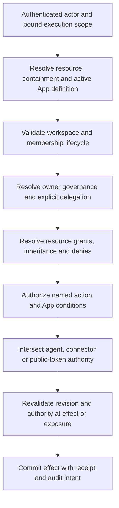

# Integral Core access-control review

Date: 10 October 2026; second scrutiny pass on the same date. Source baseline: `9d13b44e`. Status: assessment and proposed design; this review changes no runtime implementation. The recheck used the working tree at that HEAD with unrelated App/UI edits present; it is not a clean-commit qualification.

Companion: [gap-closure plan](ACCESS_CONTROL_PLAN.md). Reproducible evidence: [review evidence](../ops/qualification/access-control-review/README.md).

## Assessment

Integral has useful resource-sharing primitives, but its current rules do not deliver workspace-owner governance or a complete declarative authorization system for App functions. The central product mismatch is deliberate: workspace ownership administers membership and settings, while resource administration belongs to direct resource owners/admins. A workspace owner can be unable to see a member's private App and unable to administer its Tracks. This behavior is explicitly tested, so changing it requires revising the access contract and invariants, rather than treating existing tests as the intended product definition.

There are also concrete security and reliability defects. Highest priority: unverified-email invitation acceptance without the emailed token; disclosure of excluded Entry snapshots through events; policy-cache collisions across scopes; failure-open exclusion lookup; stale authority after ownership transfer; facade point reads that cross their bound workspace; and replayed operation outputs that disclose an Entry after exclusion. These findings are supported by isolated characterization probes. A successful probe means the reported behavior occurred, including unsafe behavior; it does not mean the security requirement passed.

Recommended direction: preserve graph-based relationships, introduce explicit workspace governance, and evaluate named actions through one server-authoritative decision contract. Separate workspace membership, resource access, App function authority, and delegation authority. A role is a convenient bundle of grants, not the complete authorization decision.

## Scope and evidence limits

Reviewed the canonical resolver and permission caches; workspace membership/creation flags; collaborator grants and exclusions; invitation creation, discovery, acceptance and revocation; share-link mint/redemption/revocation; App/Track ownership transfer and member departure; REST access surfaces; event/audit filtering; policy administration/evaluation; App operation dispatch and ToolContext; scope contracts; frontend role/session declarations; associated regression tests and invariants.

The evidence is local source review, existing targeted tests, and new isolated HTTP/service/fault-injection probes. Default test storage is JsonDB. Some execution tests replace providers or handlers with fixtures. This is not deployed-browser acceptance, production PostgreSQL concurrency qualification, an exhaustive endpoint penetration test, or proof about production configuration. Remaining qualification is explicit in the plan. No production data or credentials were used. No commits, pushes, PRs or deployment were performed.

### Trust boundaries and limits

| Actor / boundary | Required protection and explicit limit |
|---|---|
| Outsider or unverified account → invitation/workspace | Knowing an ID or claiming an email is not authority; authenticate and validate the intended acceptance ceremony |
| Member/guest/resource admin → another resource or workspace | Prevent ID substitution, scope confusion, self-grant, indirect disclosure and reuse of stale authority |
| Workspace owner → workspace data | Governs canonical workspace data; cannot cross into another workspace, personal credentials or platform administration |
| Human → resident/MCP/connector/deferred execution | Preserve original actor, effective service identity, delegation, intended targets and limits; approval is not new ambient authority |
| Anonymous token → public representation | Authority belongs to the narrow token/public audience, not an identifiable person; a suspended person can still visit genuinely anonymous content |
| Executable App → host process | Trusted Python runs inside the service trust boundary. A facade and manifest do not sandbox malicious host code; admitting untrusted executable Apps requires separate isolation |
| Storage/cache/event transport → authorization decision | Storage failures, old snapshots, retries and race order cannot turn unknown or revoked authority into a new allow |

Assets include canonical records and attachments, private session content, grant/owner relationships, App definitions and transition state, integration credentials, invitations/tokens, cached results and audit evidence. An owner who can change an App definition can change its future business rules: separation-of-duty guarantees constrain execution under the approved definition, not a hostile owner with unrestricted power to replace that definition. Stronger organizational controls require separately governed definition changes and an explicit platform authority model.

## Current access model

| Layer | Current behavior | Consequence |
|---|---|---|
| Identity | Authenticated principal resolves to a graph User; email verification does not gate login | Account authentication alone does not prove control of its claimed email |
| Workspace | `IS_MEMBER_OF` carries owner/admin/member/guest and App/Track creation flags | Membership and resource roles are different axes |
| Resource | `OWNS`, `COLLABORATES_ON`, `EXCLUDED_FROM`, visibility, parent cascade | Per-resource delegation exists |
| Role ladder | owner > admin > editor > commenter > viewer | Resource admin configures/shares; editor changes Entries |
| Parent cascade | Inherited owner/admin cap to editor | App administration does not confer Track administration |
| Workspace staff | Owner/admin get commenter only on non-private Apps/Tracks | Workspace ownership is not sovereign governance |
| Exclusion | Blocks inherited paths; direct grants win | Exclude is not an absolute block or suspension |
| Visibility | private/workspace/public, Track inherit; private Track can still inherit direct App collaborators | “Private” does not mean hidden from every parent collaborator |
| Invitations | Hash, expiry, email comparison; accept grants membership/collaboration | Good token hygiene, incomplete authority/lifecycle binding |
| Share links | Authenticated collaborator redemption; separate anonymous public contracts | Link possession can create direct resource authority and guest membership |
| Policy engine | Humans use built-in role rules; agents/connectors use explicit allow Policies; internal system bypass | Stored human Policies are not applied as App function grants |
| App functions | Operation metadata includes `policy_action` and `capability`; dispatcher gates `policy_action` | `capability` does not itself establish per-user function delegation |
| Privacy | App/Track/Entry is the boundary; no field-level visibility | Sensitive fields must be modeled as separately governed resources |

Sources: `backend/app/services/permissions.py:905`, `workspace_permissions.py:158`, `policy_engine.py:632`, `app_operations/dispatch.py:153`; `docs/INVARIANTS.md` I-ROLE-01/02/03 and I-ACCESS-01. The supplied AGENTS description and some source comments use older role/privacy descriptions. Current code and current invariants govern this assessment.

Direct resource roles return before inherited candidates are calculated. Therefore a direct viewer grant can suppress inherited editor access. “Strongest wins” is only true within the remaining inherited/visibility/staff candidates. This precedence needs a single explicit contract.

### Existing machinery to retain

Core already rejects generic writes to declared protected custom fields through `services/app_invariant_guards.py` and canonical Entry create/update services. App operation dispatch already checks workspace, membership, App lifecycle, policy and typed input/output; validates returned Entry references; and routes durable commands through PostgreSQL transaction/receipt/outbox machinery in `services/app_operations/`. Executable operations also have a trust-tier gate in `services/hooks/trust.py`. The gaps concern completeness, scope and lifecycle integration, not absence of all these controls. In particular, the protected-write flag is context-wide rather than a target/action-specific authorization proof; qualification must include unrelated operations and nested calls.

The current `modules/policy.py::decision_fingerprint` hashes decision metadata. Its `policy_revision` label is **not** a durable grant-change epoch or storage fence: a grant can change while a coarse allow decision and hash remain identical. Preserve useful evidence fingerprints, but introduce separately named, persisted authorization revisions for revocation guarantees.

## Findings and gaps

Priority: **P0** must close before claiming a secure collaboration baseline; **P1** must close for the requested owner-governed/declarative model; **P2** improves consistency and operational readiness. Priorities express remediation order, not a formal CVSS score or evidence of deployed exploitability. A design mismatch, an intentional sharing rule, an inactive helper and an externally reachable defect must not be treated as equivalent. **R** = reproduced; **S** = source-confirmed limitation; **Q** = further qualification required. Probe names are retained in the evidence file.

| ID | Priority / evidence | Finding, impact and source |
|---|---|---|
| AC-01 | P0 / R, HTTP | **Unverified email can claim invitations without the token.** Signup under an unverified address, then `/me/invitations` discovers invitations for that email; `/me/invitations/{id}/accept` accepts them, including workspace admin. Email equality is not mailbox proof. `api/shared_with_me.py:261,335`; `services/invitations.py:152,517`. Probe `test_unverified_email_can_discover_and_accept_invitation_without_token`. Require verified ownership of the current email for discovery/by-ID acceptance. A valid invitation token can authorize that specific invitation under a defined bearer/recipient contract; it must not automatically verify the account email, because the issuer also receives the acceptance URL. Keep ordinary login non-blocking. |
| AC-02 | P0 / R, service + broadcast | **Entry exclusions do not protect event snapshots.** A Track viewer excluded from an Entry receives its `entry.update` event `after` payload. Broadcast authorizes only `track:<id>`. Audit and polling use the same scope-only policy dispatch, so they require equivalent repair. `event_subscription_registry.py:85,106`; `policy_engine.py:273`; `api/audit_log.py:104`; `api/events_polling.py:103`. Probe `test_entry_exclusion_does_not_filter_event_payload`. Authorize the affected resource and snapshot contents, including nested references; define deletion-event access without bypassing former exclusions. |
| AC-03 | P0 / R | **Policy memoization omits inputs that change the decision.** Key contains subject/action/resource kind/id, but omits scope, entry type, tags, approval payload and policy revision. An allowed request can authorize another scope in the same context. The event subscription helper uses constant kind/id, so two Track scopes collide directly. `policy_engine.py:685`; `middleware/permissions_cache.py:15`; `event_subscription_registry.py:94`. Probes `test_policy_cache_ignores_scope_and_tags`, `test_event_subscription_decision_cache_crosses_track_scope`. Include complete immutable decision inputs; do not cache effect/approval creation. Start fresh, live authorization for each event. |
| AC-04 | P0 / R, injected storage fault | **Exclusion read fails open.** `_is_excluded_from_resource` catches an exception and returns False; an excluded user then inherits editor. `permissions.py:817`. Probe `test_exclusion_storage_error_allows_inheritance`. An indeterminate denial lookup must produce denied/unavailable, not “no exclusion.” Review all authority helpers for equivalent exception/default behavior. |
| AC-05 | P0 / R, facade | **Point reads cross the bound workspace.** `ToolContext.get_entry/get` checks the user's resource role, but not the context's workspace or permitted App scope. A user authorized in workspaces A and B can read B through an A-bound facade; `get` labels the result as A. `hooks/registry.py:212,226`; inherited by `OperationContext`. Probe `test_facade_point_read_crosses_bound_workspace`. Resolve structural ownership and enforce execution workspace and App-declared reference authority for every facade method. This reproduces a scope breach for a principal authorized in both workspaces, not arbitrary-user access to B. |
| AC-06 | P0 / R locally; S/Q across workers | **Revocation is not reliable across all caches.** Transfer leaves the former owner's warmed process role at owner until TTL expiry, enabling owner-only gates to remain open. Process cache defaults to 20 seconds and invalidation is in-memory per process. `ownership_transfer.py:16,86`; `permissions_process_cache.py:32,36,94`; `permissions.py:939`. Probe `test_ownership_transfer_leaves_warm_owner_cache`. Audit visibility/parent/lifecycle changes too. Durable authorization revisions must fence every worker and effect; local invalidation is only an optimization. |
| AC-07 | P0 / R, ordered race + stale issuer | **Invitation authority and status can become stale.** A resource admin can issue an invite, lose all authority, and the invite still grants editor. Acceptance can observe pending, then complete after revoke has persisted. `invitations.py:371,437,477,517,763`. Probes `test_stale_inviter_still_confers_resource_grant`, `test_invite_accept_can_win_after_revoke`. Bind invitations to issuing authority and target workspace/policy revision; atomically claim pending status and materialize grants. Define authorized workspace-owner adoption of outstanding invitations. |
| AC-08 | P1 / R + invariant | **Workspace owners cannot govern all workspace resources.** A member's private App can be invisible to the workspace owner. Non-private inventory grants only commenter. Parent owner/admin caps at editor. `workspace_permissions.py:158`; `permissions.py:1030,1060`; I-ROLE-02; `test_app_owner_grant.py:151`. Probe `test_owner_governance_mismatch`. Introduce governance as a separately evaluated source of authority and revise the existing invariant deliberately. |
| AC-09 | P1 / R, HTTP | **Selective creation grants can be self-assigned by workspace admins.** An admin with both creation flags False can PATCH its own membership to True. `api/workspaces.py:779,791,825`; `permissions.py:210,235`. Probe `test_workspace_admin_self_assigns_creation_rights`. If administrators are intentionally allowed to do this, false flags are advisory limits. Recommended: explicit delegation permissions and ceilings, with owner-controlled grant administration. |
| AC-10 | P1 / R; policy choice | **Offboarding does not prevent re-entry.** Removing membership/grants does not create a suspension/removal embargo; a valid old share token adds guest membership again. Exclusions likewise lose to a redeemed direct grant. `workspace_departure.py:44`; `sharing.py:185`; `share_links.py:342`. Probes `test_removed_member_can_rejoin_via_existing_share_link`, `test_share_redeem_overrides_exclusion_and_link_revoke_retains_access`. Distinguish voluntary leave, resource removal and owner suspension; suspended users must not rejoin through old invitations/links. |
| AC-11 | P1 / R + S | **Ownership transfer is not an atomic ownership operation.** The service deletes owner/target collaborator edges before writing the replacement; a failed wire leaves no OWNS edge. Neither App nor Track transfer opens the graph transaction used by departure. Collaborator role owner passes delete but fails canonical OWNS-based transfer. `ownership_transfer.py:16,86`; `permissions.py:490,556`; `sharing.py:386`. Probes `test_transfer_write_failure_leaves_no_owns_edge`, `test_collaborator_owner_can_delete_but_cannot_transfer`. Separate canonical ownership from delegable role bundles; single-owner uniqueness, compare-and-swap transfer, receipts and cache fencing are required. |
| AC-12 | P1 / R + S | **Missing scope anchors disable the workspace membership gate.** If workspace lookup returns None, resolution continues with direct/inherited grants. Default workspace deletion unlinks resources and clears `workspace_id`, manufacturing this condition; it also conflicts with rooted inclusion. `permissions.py:879,1017`; `workspace_lifecycle.py:72,104`; `api/workspaces.py:523`. Probe `test_missing_workspace_anchor_allows_direct_grant`. Corrupt/unresolved containment must fail closed. Delete/archive/explicitly rehome resources in a validated transaction; never create unscoped survivors. |
| AC-13 | P1 / S; engine behavior R; reachability Q | **Administering a policy subject is not a target-authority ceiling.** Policy CRUD checks that the caller owns/administers the agent/connector, but accepts wildcard scope/actions without checking all target authority. Engine matches an agent/connector Policy without intersecting the owner's current membership/resource authority. `api/policies.py:71,180`; `policy_engine.py:710`; `policy_registry.py:62`. Probe `test_policy_authority_scope_is_not_intersected` uses a synthetic wildcard Policy and confirms engine behavior, not an end-to-end connector exploit. Native resident dispatch commonly uses the human perimeter, so this is not evidence every resident call bypasses human access. Constrain issuance and intersect at every execution boundary. |
| AC-14 | P1 / S | **Declarative App functions are not fully delegable.** Human Policies are bypassed by the human default branch; operation `capability` is metadata while execution uses coarse `policy_action`. No complete user/group-to-App-action grant contract appears in the reviewed dispatcher. `policy_engine.py:701`; `app_operations/dispatch.py:59,153`; `schemas/app_operations.py:10`. Need namespaced actions, role bindings, bounded conditions, grant administration and identical enforcement across surfaces. |
| AC-15 | P2 / R, HTTP + S | **Directory privacy differs by endpoint.** A viewer receives a reduced `/access`, but legacy `/apps/{id}/collaborators` returns other people and roles. Any guest can list the workspace member pool; public Track mention candidates can search graph Users. `sharing.py:959`; `api/apps.py:901`; `api/tracks.py:765,1076`; `api/workspaces.py:663`. Probe `test_viewer_legacy_collaborators_enumerates_other_people`. Define separately permission to read content, mention eligible people, and inspect access administration. Apply it consistently, with minimal user-field projections. |
| AC-16 | P2 / R, HTTP | **Workspace avatar gate treats “none” as truthy.** `if not await can_access_workspace(...)` does not deny the nonempty string `"none"`; a non-member can fetch the logo. `api/workspaces.py:1312`. Probe `test_avatar_non_member_truthiness`. Low-sensitivity payload, clear IDOR-style gate defect. Use typed decisions or explicit role comparisons; audit other truthiness callers. |
| AC-17 | P1 / S + R; contract decision | **Roles and helper behavior disagree.** Viewer authors can edit/delete their own Entry through the author shortcut; I-ROLE-01 says viewer cannot mutate. The comparison is against the supplied principal ID, making graph/auth aliases another consistency concern. Direct viewer overrides stronger parent editor; resource owner and canonical owner differ. `permissions.py:581,1030`; I-ROLE-01. Probes `test_viewer_author_can_edit_own_entry`, `test_direct_viewer_suppresses_inherited_editor`. Specify author rights as an explicit capability/condition, canonicalize identity, and make precedence explicit. |
| AC-18 | P1 / S/Q | **Governance lifecycle and evidence are incomplete.** No workspace ownership-transfer endpoint was found, although leave/account deletion messages require transfer. Workspace member changes live in API code with delete/recreate rollback, unlike the transactional departure service. Resource admins can issue invitations, but the resource invitation-revoke endpoint accepts only owner. Workspace changes often emit `scope=user:<actor>`, so the workspace owner lacks a complete workspace-governance audit view. Scope schemas even omit workspace as a ResourceKind despite workspace action branches. `api/workspaces.py:779,832,963`; `api/invitations.py:370`; `schemas/policy.py`; `api/policies.py:521`. Need canonical membership services, transfer/recovery, consistent scope types, workspace audit, bounded/paginated inventories and verified migration/repair. |
| AC-19 | P2 / S; module import and external reachability incomplete | **The legacy generated-document list has the same truthiness pattern and insufficient row filtering.** `documents/generate.py:361` treats workspace role `"none"` as allowed. With no context Entry filter, the source returns all matching GeneratedDocument rows without per-document/context authorization; rows can contain resolved snapshots. Attempted service reproduction could not import the module because `template_lifecycle.py` imports missing `HAS_TEMPLATE_VERSION`. No external HTTP caller of this function was found. This is source-confirmed legacy debt, not a reproduced document-disclosure exploit. Reconcile/remove the inactive module, or repair its imports and authorization before exposing it. Treat this as a release blocker only if the affected module is included as a supported reachable surface; do not revive dead code merely to fix it. |
| AC-20 | P0 / R, read-operation dispatch; command replay S/Q | **Operation replay can expose a now-excluded Entry.** A synthetic read handler checks the actual Entry permission and returns a validated Entry reference. After exclusion, a fresh operation invocation denies, but retrying the old idempotency key returns the original title/reference without rerunning the handler or reference authorization. App-level invocation permission still holds. `app_operations/dispatch.py::invoke_app_operation` returns `lookup_idempotent_result` before `build_result`; durable command replay similarly returns `execution.result`. Probe `test_read_operation_replays_entry_after_exclusion` exercises real policy, the warm in-process read-result cache and dispatch with only the App handler substituted. Clearing that cache did not reproduce persistent replay in this JsonDB fixture; do not infer cross-restart disclosure from this probe. Command/PostgreSQL replay is source-confirmed and still needs runtime qualification. Preserve effect idempotency while reauthorizing result disclosure; do not rerun an already committed mutation to regenerate its response. |
| AC-21 | P1 / R, service + response source | **Accepted invitation metadata can overstate the resulting grant.** An existing viewer accepts an editor invitation; acceptance is saved as successful/editor while effective access remains viewer. `_materialize_invitation_grants` calls `ensure_edge`, which returns an existing edge without updating its attributes. Acceptance endpoints report the invitation's requested role rather than a verified effective result. Probe `test_accepted_invitation_reports_role_not_materialized`; `invitations.py::_materialize_invitation_grants`, `edge_upsert.py::ensure_edge`, `api/shared_with_me.py::post_accept_my_invitation`. This is a grant/receipt consistency defect, not an escalation. Define explicit existing-member/collaborator upgrade, no-op and conflict semantics, protected by version checks; never blindly overwrite newer grants. |

Additional hardening to qualify: grant/exclusion uniqueness and concurrent upserts; link revoke versus already reserved redemption; replay after grant persistence but receipt/status/audit failure; user-account disable/session revocation; public-share extensions and secondary references; notifications and old payloads; search/vector/result-set/dashboard/export permission parity; stale App-definition operation grants; executable App trust boundary. Source review identifies these obligations, but does not assert that each is a reproduced exploit.

Frontend tokens, including refresh tokens, are stored in localStorage (`frontend/src/api/session.ts:86`). This increases the impact of XSS; it is a session-hardening risk, not evidence that XSS was found. Evaluate a same-origin HttpOnly cookie/BFF design with explicit CSRF/CORS behavior while retaining a deliberate bearer-token model for MCP and non-browser clients. Owner transfer, bulk access changes and destructive governance should support reauthentication and qualified MFA. Do not invent a Core dependency on a commercial identity provider.

## Target authorization contract

### Workspace owner and delegation

The workspace owner governs all canonical Apps, Tracks, Entries and shared configuration structurally belonging to that workspace, including resources created by members and resources labeled private. The owner can inventory, inspect access, read/manage workspace data, administer schema and App lifecycle, reclaim/transfer resource ownership, revoke sharing, suspend members, and inspect workspace governance audit. Ownership of workspace A confers no authority in B. The owner's personal credentials and unrelated personal workspace are separate scopes; ownership does not export another person's provider secrets.

Treat workspace owner as a protected governance principal. Do not materialize an owner edge on every child, or promote all inherited App admins to owner. The governance authority is resolved from verified containment and the current workspace owner. A creator's OWNS edge can continue to represent resource stewardship, while the workspace owner's governing powers do not depend on that creator.

Delegate workspace administration through named permissions: membership management, access administration, creation, App installation/configuration, shared integrations, audit, and destructive actions. Default workspace admin may manage ordinary members/settings; it cannot grant itself omitted powers, appoint peer admins, suspend the owner, transfer workspace ownership, or exceed its delegation ceiling. Specific additional administrative permissions are owner-assigned. A simple UI can present presets backed by these capabilities.

Platform-disabled accounts and unavailable/invalid containment still deny the owner; owner protection is against ordinary workspace/resource ACL changes, not the platform identity lifecycle.

Private means restricted to ordinary audiences, including ordinary workspace members; it does not mean hidden from the governing workspace owner. Clearly disclose this in product copy. Personal workspaces remain personal; intentional resource sharing creates guests with narrow authority. Membership creation flags, profile publication, and guest-directory exposure need identical semantics in both kinds.

### Permission composition and lifecycle rules

| Question | Recommended rule |
|---|---|
| Does an App role expose all App data? | No. For a normal user, reading an App-managed record requires its resource audience grant and the App's declared read action. Standalone Tracks use Core actions. A role assignment may explicitly bundle both grants, with the audience expansion shown before saving. |
| Can an approver act without generic editor rights? | Yes, when the actor can reach the target record and has the exact transition action. The command may write only the declared transition fields/relations under its conditions. Generic PATCH still requires edit rights and cannot write protected fields. Do not require blanket editor access merely to approve. |
| Does owner governance imply every business action? | The owner always retains inventory, canonical-data read and governance/recovery powers. Business commands use explicit action grants and current App conditions; the owner can assign roles but does not silently bypass a separation-of-duty rule. Recovery/override is a separate, audited action. |
| Does an exclusion remove all access? | An inherited exclusion suppresses the inherited paths arriving at that resource; direct allowed paths remain. Absolute blocks apply to the named resource and its descendants by default, across direct/group/token-derived grants. Only authorized governance can change a block; moving a resource requires an audience diff. |
| What happens to existing grants when their issuer leaves? | Accepted human collaboration grants are durable workspace grants unless explicitly dependent or expiring. Issuer removal alone does not silently delete other users' accepted grants. Pending invitations need live issuer authority or owner adoption; service delegation and dependent subdelegation retain an explicit live authority chain. |
| What does suspension cover? | Identified access, guest creation, outstanding authenticated invitation/redemption paths, sessions and delegated execution. It cannot prevent the same person accessing an anonymous publication; remove public exposure or require identity if that guarantee is needed. |
| Can personal workspace ownership be transferred? | No ordinary transfer of an account's auto-created personal workspace. Transfer applies to collaborative workspaces; deliberately move/share canonical resources using separate source/destination authorization. Account recovery is an identity operation. |
| What happens when two groups conflict? | Start with flat workspace-scoped groups. Union valid action allows; apply explicit blocks and mandatory conditions after that union. Each grant's own constraints must be satisfied together; never combine one grant's target scope with another's action. Nested/dynamic groups require a later bounded, cycle-safe contract. |

Administrative authority is distinct from acting authority: an editor cannot alter grants, membership, owner fields, workspace/parent bindings, App policy declarations, protected state or other security attributes through generic data updates, import, bulk edit or a tool. Grant administrators may delegate only explicitly delegable actions/scopes/durations; subdelegation requires an explicit ceiling. Name and validate the permissible changes at the canonical mutation service, regardless of transport.

### Decision order for identified requests



1. Normalize the authenticated graph/auth identity; server binds tenant/workspace, actor and origin. Client IDs select candidates, never authority. Unsupported/unknown actions deny.
2. Resolve structural containment. Require one valid workspace for a workspace resource and reconcile scalar caches against that binding. Missing/ambiguous containment or indeterminate authority denies.
3. Check live account and workspace membership on identified paths. Suspended users cannot use those paths; old grants/tokens cannot silently restore membership. Public-token requests use a separate narrow audience contract and cannot prove the visitor is not a suspended person.
4. Resolve protected workspace-owner governance or scoped delegated governance. An ordinary resource grant/exclusion cannot remove the owner's governing authority.
5. For ordinary participants, combine valid grants by declared precedence. Recommended base rule: strongest applicable allow; inherited exclusion only removes inherited paths. A separately named resource/workspace block overrides ordinary direct grants and authenticated token redemption within its defined descendant scope. Do not use a lower direct role as an undocumented deny.
6. Evaluate the exact action. Author-only rights, App roles and bounded conditions must be explicit. Reading an App, editing an Entry, approving a business transition, configuring schema, sharing, and deleting are independent decisions.
7. Intersect acting-user authority with non-human/token permissions, current workspace scope, App declarations and platform limits. Owning a connector or obtaining approval cannot amplify target authority. Internal system calls use a narrowly documented authority origin and typed scope.
8. Recheck current revisions before side effects and result exposure. Persist grants/effects and durable receipt/audit intent atomically where supported. Unknown or interrupted outcomes require reconciliation rather than assumed success.

Grant administration also authorizes itself: caller, target subject, target workspace/resource/action, grant ceiling, expiry, provenance and policy revision are validated together. Owning an App package is not authority over another installed App instance. Platform operator privileges remain explicit operational roles; workspace ownership cannot alter the substrate's security rules.

### Declarative App contract

Use the same domain-neutral Core contract for human UI, REST, resident AI, MCP, routines, hooks, connectors, exports and deferred approvals. Apps declare namespaced functions and their required inputs/conditions; workspace owners bind users or rooted groups to App roles. Core enforces scope, delegation, evaluation, lifecycle, concurrency and audit. Apps define domain meanings and workflow rules through supported declarations/trusted operations.

Proposed manifest vocabulary, **not currently executable syntax**:

```yaml
access:
  version: 1
  actions:
    record.read: {effect: read}
    record.edit: {effect: write}
    request.submit: {effect: write}
    request.approve: {effect: write}
    settings.manage: {effect: configuration}
  roles:
    reader: {allow: [record.read]}
    contributor: {allow: [record.read, record.edit, request.submit]}
    approver: {allow: [record.read, request.approve]}
  rules:
    - action: request.approve
      require:
        all:
          - {resource.state: submitted}
          - {actor.id_not_equal: resource.submitted_by}
```

At installation, bind these names to immutable App-instance/action identities. This illustration omits the eventual schema's mapping to typed operation keys, eligible resource/Entry types, condition attributes and the workspace grant-administration envelope. Conditions require a bounded, typed, versioned expression schema with allowlisted server-derived attributes; no arbitrary Python/eval, user-supplied identity claims or blanket wildcard expansion into future sensitive actions. New or materially changed actions start ungranted unless explicitly covered by a reviewed compatibility rule. Sensitive transitions must not be reachable by generic Entry PATCH that bypasses the transition operation.

App roles supplement resource access; an approver grant does not grant every App Entry edit, and a record reader does not become an approver. Action checks return explainable source grants and current revision. Detailed grant/denial explanations are themselves access-controlled: ordinary callers receive safe reason codes, while governance callers can inspect the underlying grant paths without exposing secrets. Any UI capabilities are computed from the same contract, while backend checks remain authoritative.

Resource-level privacy remains the default. A single readable Entry cannot safely contain a field hidden only by a renderer. Store differently governed content in separately governed linked resources and filter relations, paths, counts, summaries, event snapshots and exports. Field-level ACL would be a separate substrate design with complete serialization/query/event consequences; do not claim it exists.

### Revocation, replay and external effects

Authorize a database mutation under the same transaction/fence that orders it against revocation. Checking a version before entering the transaction still leaves a race. For a read or stream, define the exposure point as the final server authorization check before each response/chunk is released to transport. Stop subsequent deliveries after a winning revocation; bytes already released, browser copies and completed exports cannot be recalled. State any signed-download/CDN expiry bound separately and avoid claiming immediate revocation for independently valid URLs.

Idempotency prevents repeating a committed effect; it does not authorize disclosing its historical result forever. Retain the immutable internal receipt, but reauthorize the response's records/references and redact or withhold inaccessible output on replay. A fresh action grant on the parent App is insufficient. Record explicit result dependencies or conservatively withhold arbitrary output whose current audience cannot be proven. Permission change must not cause a retry to execute a previously committed side effect again. A definition update also cannot reinterpret an old idempotency key as a new command.

An external provider request cannot share a database transaction with membership revocation. Record an authorized dispatch intent, check the current fence before dispatch, and record the point beyond which cancellation is best effort. Distinguish pending, dispatched, confirmed, failed and unknown outcomes; reconcile ambiguous provider success with provider idempotency keys/receipts where supported. Do not claim exactly-once external execution from a local receipt alone.

## Use-case and acceptance matrix

The following matrix enumerates the practical collaboration scenarios and boundaries required for release. “Target” is the proposed design, not a claim that current code supports it. Each case requires both an authorized completion and a prohibited-action test. Use at least two workspaces, two independent resource stewards, owner/admin/member/guest/outsider identities, and graph/auth principal aliases.

| Case | User journey | Target behavior / essential negative boundary |
|---|---|---|
| U01 | Owner creates collaborative workspace | Exactly one canonical owner; owner can govern all descendants |
| U02 | Owner invites existing verified user | Preview exact workspace/role/creation rights; acceptance adds membership once |
| U03 | Owner invites new user | Verified current email or invitation-specific token authority binds the intended acceptance; wrong email or unverified by-ID claim denied |
| U04 | Owner invites workspace administrator | Explicit governance preset/ceiling; recipient cannot appoint owner or self-expand |
| U05 | Owner invites ordinary member | No creation/config/write authority beyond granted rights; visible audience rules apply |
| U06 | Owner invites external guest to one App/Track/Entry | Narrow guest membership plus exact resource grant; no unrelated resources/member directory |
| U07 | User has several workspaces | Explicit scope isolates reads, effects, cache, relations and receipts; A cannot bleed into B |
| U08 | Owner resends/replaces invitation | Previous token revoked; pending invitation version and deliverability outcome explicit |
| U09 | Invitation expires, is declined or revoked | No grant; terminal transitions atomic; generic invalid-state error avoids enumeration |
| U10 | Invitation issuer loses authority | Pending grant invalidated or explicitly adopted by owner; no stale issuer grant |
| U11 | Two clients accept, or accept races revoke | One durable transition; retry returns receipt; revocation ordering defined |
| U12 | Member already joined by another path | Invitation cannot silently overwrite a newer role/ceiling |
| U13 | Owner edits membership role or creation rights | Atomic versioned update, previous/effective rights shown, immediate worker-wide effect |
| U14 | Delegated admin manages members | Restricted to its grant ceiling; cannot alter owner or protected peer governance |
| U15 | Admin tries self-assigned creation/sharing privileges | Denied unless separately delegated grant-administration authority covers them |
| U16 | Member creates App/standalone Track | Creation flag checked; rooted resource; owner retains governance |
| U17 | Member creates Track within App | Workspace creation + App configuration requirements both enforced |
| U18 | Owner inventories member-created private content | Complete inventory and effective access; private restricts ordinary members |
| U19 | App steward adds viewer/commenter/editor/admin | Each advertised permission is enforced; resource admin does not implicitly gain canonical ownership or workspace deletion/transfer |
| U20 | App grant reaches contained Tracks/Entries | Explicit inheritance semantics; scope/cap shown; no accidental config delegation |
| U21 | Owner delegates subtree configuration | Separate scoped governance grant where intended; App admin alone is not an undocumented blanket grant |
| U22 | Standalone Track is shared | No App assumed; same grant/revocation semantics as contained Track |
| U23 | Track opts out of parent audience | Explicit inherited-access setting; effective audience preview before change |
| U24 | Entry is shared without sharing Track/App contents | Only minimal parent navigation metadata; related records remain independently authorized |
| U25 | Direct grant meets inherited exclusion | Exclusion only removes inheritance; UI clearly shows remaining direct access |
| U26 | Owner blocks a user absolutely | Named block/suspension beats identified ordinary grants/redemption in the defined subtree; owner remains protected; anonymous-public limit disclosed |
| U27 | Owner removes one collaborator grant | Other grant paths may remain; effective after-state reported, not “access revoked” by assumption |
| U28 | Different direct/inherited roles overlap | One documented precedence rule; test lower direct role and stronger parent role |
| U29 | Viewer/commenter edits authored Entry | Only explicit author-edit/delete capability permits it; viewer default remains read-only |
| U30 | Commenter posts, reacts, edits own comment | Entry authorization applies; viewer posting and excluded-Entry posting denied |
| U31 | Curator moderates another's comment | Moderation action distinct from commenting; rewriting another's text denied |
| U32 | Owner transfers App/Track stewardship | Live eligible target, single owner, atomic receipt, failure/replay safety |
| U33 | Owner reclaims orphaned resource | Governed repair with audit; missing scalar/edge consistency cannot strand authority |
| U34 | Collaborative workspace owner transfers ownership | Eligible verified member accepts; personal workspace transfer denied; old/new authority atomic; last-owner protection |
| U35 | Member leaves voluntarily | Grants cleaned up, resource stewardship reassigned, personal scope restored |
| U36 | Owner removes/suspends departing employee | No re-entry via outstanding credentials; grants, routines, approvals and shared integrations fenced |
| U37 | Suspended member resumes | Owner explicitly restores reviewed membership/grants; stale grants do not automatically resurrect |
| U38 | Owner mints authenticated collaborator link | Owner-controlled external-sharing policy, role ceiling, expiry and redemption cap |
| U39 | Link reaches wrong/forwarded person | Bearer audience explicit; email/domain binding where required; stronger authority never implicit |
| U40 | Same user redeems link repeatedly | Idempotent grant; receipt distinguishes existing access, upgrade and no-op; cap policy explicit |
| U41 | Redemption races expiry/revoke/cap | Atomic reservation + grant/receipt, no grant after winning revocation, no wasted capacity on retry |
| U42 | Owner revokes link versus recipients | “Disable future redemption” and “revoke grants sourced from link” are separate explicit actions |
| U43 | Owner shares anonymously | Explicit public contract; minimal fields/relations/attachments/actions; anonymous token grants no general workspace rights |
| U44 | Public form/comment/upload is enabled | Each write is separately declared and abuse-limited; declared public-audience/token/validation constraints apply; identity-specific restrictions require authentication |
| U45 | App exports public-share extension | Active trusted declaration, typed input/output, server scope and action gate; no handler bypass |
| U46 | Reader requests member/collaborator/mention lists | Minimum directory visibility; content read does not imply full access-administration inspection |
| U47 | Excluded Entry changes | WebSocket, poll, audit, notification and webhook representations do not disclose denied payload |
| U48 | User searches/counts/aggregates/exports | Authorized rows, fields, totals, labels and relation paths agree with direct reads |
| U49 | Owner assigns App function roles | Named users/groups receive exact functions; approver ≠ editor ≠ schema admin |
| U50 | Business action has state/author condition | Bounded server-derived condition; generic CRUD cannot bypass transition or separation-of-duty rule |
| U51 | Group membership grants App access | Rooted workspace group; changes revoke downstream grants consistently |
| U52 | App update adds/changes functions | New authority reviewed; immutable definition revision; stale action grants fail closed |
| U53 | Resident or MCP acts for a user | Same scope/data/function rights; prompt, client subject or tool argument cannot elevate actor |
| U54 | Approval waits while permission changes | Execution rechecks actor, reviewer, scope, policy, revision and target state; no stale approval authority |
| U55 | Routine/hook/connector resumes after revocation | Fresh boundary, current owner/delegation intersection; provider side effect not assumed reversible |
| U56 | App calls sibling tool or point-read facade | Declared installed capability/reference, user permission and bound workspace all required |
| U57 | Owner configures shared integrations | Shared configuration manageable; personal provider secrets remain separately scoped and non-exportable |
| U58 | Permission database/cache/network fails | Denied or unavailable; never broaden access; no fabricated empty success |
| U59 | Concurrent grant/transfer/offboard operations | Storage uniqueness, locking/CAS, fencing and immutable receipts prevent partial authority |
| U60 | Owner deletes/archives/re-homes workspace data | No unscoped survivors; complete lifecycle handling, audit and recovery semantics |
| U61 | User logs out/account disabled/session revoked | Browser, refresh, MCP and sockets respond under documented session/revocation bound |
| U62 | Owner asks “who can do what, and why?” | Effective user/group/action/resource report including direct/inherited/token/governance sources |
| U63 | Malformed/omitted scope or inconsistent parent supplied | Supplied malformed scope rejected; omitted ordinary scope deliberately defaults personal; corrupt parent denies |
| U64 | Access review at scale | Complete paginated inventory and receipts; no silent truncation, wildcard overgrant or misleading totals |
| U65 | Client retries an operation after record access is revoked | Committed effect is not repeated; historical output/references are filtered or withheld under current access |
| U66 | Invite accepted by an existing collaborator/member | Receipt reports granted/upgraded/unchanged/conflict and actual effective rights; advertised role is not assumed materialized |
| U67 | User changes email or invitation token is forwarded | Verification belongs to the current email; token consumption authorizes only the intended invitation, not global email verification |
| U68 | Entry/Track is moved, copied or bulk imported | Source and destination actions checked; inherited audience/provenance diff explicit; no owner/workspace/security-field mass assignment |
| U69 | App install/update/uninstall/restore changes access definitions | Lifecycle is owner-delegated; no silent new grant, stale group/action binding, public audience or old token resurrection |
| U70 | User belongs to overlapping App groups | Each allow is satisfied as one complete grant; scope/action constraints cannot be mixed; block wins; cross-workspace membership denied |
| U71 | User opens an attachment/download URL after revocation | Metadata, thumbnail, file bytes and external URL issuance all authorized; independently valid URL expiry/revocation bound is explicit |
| U72 | Routine writes through shared integration after creator leaves | Workspace-owned service delegation is adopted/reviewed explicitly; personal credentials are not silently transferred; unknown provider outcome reconciled |
| U73 | Owner changes workflow rules or requests emergency override | Definition-change and override authority are explicit and audited; execution conditions cannot be silently bypassed by a generic operation flag |
| U74 | Viewer asks why another person has access | Safe caller explanation; full grant-path/user/policy details require access-review authority |
| U75 | Backup is restored after revocation | Quarantined restore reconciles live revocations/epochs/credentials before serving; revoked actors and public tokens cannot reappear silently |
| U76 | Permission service is partitioned or a long stream is active | Unknown current authority fails closed; release-point semantics and already-delivered data limits tested and documented |

## Design decisions to ratify before migration

Recommended defaults: workspace owner governs its canonical workspace data; delegated admins have explicit ceilings; ordinary resource admins remain scoped; viewer is read-only; author rights are declared; overlapping allows use strongest applicable grant; inheritance exclusions and absolute blocks are distinct; suspended users cannot redeem authenticated collaborator tokens; link expiration ends future redemption unless an expiring source grant was explicitly selected; revoke-link and revoke-recipient-grants are separate actions; anonymous public capabilities require explicit workspace permission and App declarations.

Private workspace-bound chat/execution records need an explicit audience contract: owner governance of canonical workspace knowledge must not accidentally make all personal sessions readable. Promote records intended for organizational retention into workspace-governed resources. Define owner audit metadata, transcript disclosure and credential boundaries before migration. This privacy decision does not change the requirement that Apps/Tracks/Entries inside the governed workspace remain governable.

Workspace-owner governance intentionally changes the prior owner/privacy contract. Existing private resources need a migration preview and clear audience notice. Preserve original permission edges and generate a before/after access diff; do not silently reinterpret historical “private” as a claim of privacy from the owner.

## External design basis

Use default-deny, least privilege, consistent checks on every request and relationship-aware authorization as described by the [OWASP Authorization Cheat Sheet](https://cheatsheetseries.owasp.org/cheatsheets/Authorization_Cheat_Sheet.html). The named-action/typed-condition proposal follows the subject/resource/action/environment approach in [NIST SP 800-162](https://csrc.nist.gov/pubs/sp/800/162/upd2/final). These inform the design; they do not certify Integral or replace the concrete source findings and acceptance evidence above.
